<p align="center">
  <picture>
    <source media="(prefers-color-scheme: dark)" srcset="docs/assets/readme/logo-dark.svg">
    
  </picture>
</p>

<h1 align="center">MendCode</h1>

<p align="center"><sub>Code. Mend. Repeat.</sub></p>

<h3 align="center">Your coding agent. Your rules.</h3>

<p align="center">As little or as much coding agent as you want: in the terminal, with sessions that outlive the window.</p>

<p align="center">
  <a href="https://github.com/MendCode/MendCode/actions/workflows/ci.yml"></a>
  <a href="https://github.com/MendCode/MendCode/releases"></a>
  <a href="LICENSE"></a>
  <a href="https://www.mendcode.dev/"></a>
  <a href="docs/"></a>
</p>

<p align="center">
  <a href="https://www.mendcode.dev/">Website</a> ·
  <a href="#install">Install</a> ·
  <a href="docs/commands.md">Commands</a> ·
  <a href="docs/">Docs</a> ·
  <a href="https://github.com/MendCode/MendCode/releases">Releases</a> ·
  <a href="CONTRIBUTING.md">Contributing</a>
</p>

One daemon keeps your sessions; any number of terminals attach to them. MendCode runs its own native engine with the models
you connect, or drives Claude Code, Codex, ACP agents and pi behind the same screen. It indexes your code into a graph so the
model reads less, packs long conversations instead of forgetting them, keeps a memory you can read and edit, and reviews your
pull requests.

<p align="center">
  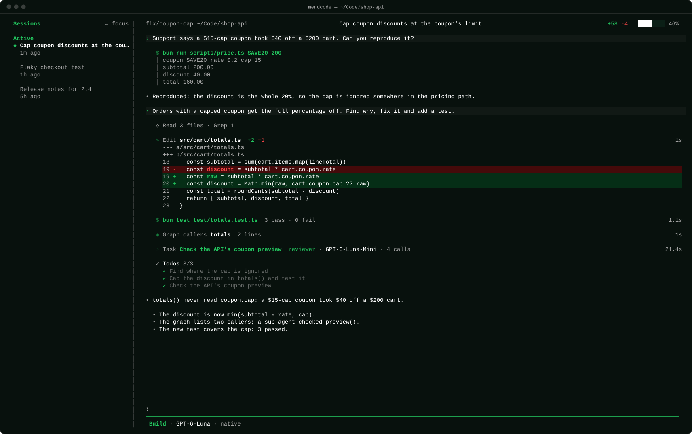
</p>

## Contents

- [Why MendCode](#why-mendcode)
- [Install](#install) · [First run](#first-run)
- [What it does](#what-it-does): [sessions](#sessions-that-outlive-the-terminal), [/env and /privacy](#credentials-with-env-private-chats-with-privacy), [pull request reviews](#pull-request-reviews), [memory](#memory-you-can-read-and-edit), [profiles and areas](#profiles-and-areas), [long work](#goals-loops-and-sub-agents), [/changes](#review-the-diff-before-you-commit), [engines](#one-screen-several-engines)
- [Status](#status) · [Build from source](#build-from-source)
- Reference: [views](#replaceable-views), [script workflows](#script-workflows), [Markdown](#markdown-renderer), [process modes](#process-modes), [terminal details](#terminal-details), [tiers](#tiers), [measurements](#measurements), [engines](#engines), [embedding](#embedding), [security](#security-model), [docs](#docs-and-development)

## Why MendCode

| You want | What MendCode does |
|---|---|
| Work that survives a closed terminal | Sessions live in a daemon; close the window and the turn keeps running, attach again from any terminal ([remote](docs/remote.md)) |
| The subscriptions you already pay for | Sign in with ChatGPT, or run Claude Code and Codex as engines with their own logins ([setup](docs/setup.md)) |
| A model that reads less of your repository | A code graph answers where a symbol is and who calls it, with exact `file:line` ([code graph](docs/code-graph.md)) |
| Long sessions that do not forget | Compaction packs the conversation and keeps a scratchpad of what was folded ([compaction](docs/compaction.md)) |
| Reviews you can trust | Two passes on every pull request: one finds defects, a fresh one tries to refute each ([PR reviewer](docs/pr-review.md)) |
| A whole setup you can swap and share | One profile carries a theme, home screen, prompt, keys, views, skills and commands; turning it off puts everything back ([profiles](docs/profiles.md)) |
| Work kept apart from personal | An area is a set of folders with its own user memories, model roles and default permission, applied without switching ([areas](docs/areas.md)) |
| As much or as little as you like | Three tiers, minimalist, balanced and full, from a plain prompt to every panel ([tiers](#tiers)) |

## Install

macOS and Linux:

```sh
curl -fsSL https://github.com/MendCode/MendCode/releases/latest/download/install.sh | sh
```

Windows (PowerShell 5.1 or newer):

```powershell
irm https://github.com/MendCode/MendCode/releases/latest/download/install.ps1 | iex
```

Then run `mendcode`. The binary goes to `~/.local/bin/mendcode` (`%LOCALAPPDATA%\Programs\mendcode` on Windows). Download and
read the script first if you prefer: it is attached to every [release](https://github.com/MendCode/MendCode/releases).

### Installer options

| Option | What it does |
|---|---|
| `--channel stable\|beta\|nightly` | Which releases to follow ([channels](#channels)); `upgrade` remembers it |
| `--tier minimalist\|balanced\|full` | The tier of the first launch (default `balanced`); minimalist opens straight to the prompt, with no setup page ([tiers](#tiers)) |
| `MENDCODE_VERSION=v0.0.1` | One exact release instead of the newest of the channel |
| `MENDCODE_INSTALL_DIR=<dir>` | Where the binary goes (default `~/.local/bin`) |
| `MENDCODE_REQUIRE_SIGNATURE=1` | Refuse to install unless the cosign signature was checked |

Options go after `sh -s --`, for example:

```sh
curl -fsSL https://github.com/MendCode/MendCode/releases/latest/download/install.sh | sh -s -- --channel nightly --tier full
```

### What the installer checks and prints

The binary's SHA256 must match its line in the release's `SHA256SUMS` before anything is written. With
[cosign](https://docs.sigstore.dev/cosign/system_config/installation/) installed, the signatures of `SHA256SUMS` and of the binary
are checked too, bound to this repository's release workflow and the exact tag. A run ends like this:

```text
Verified SHA256 and the cosign signature of v0.0.2-nightly.20261101.18
Installed mendcode 0.0.2-nightly.20261101.18 to /Users/you/.local/bin/mendcode (starting tier: balanced)
Run mendcode to start. mendcode upgrade updates it; --channel beta or nightly switches channel.
```

Without cosign the first line says `Verified the SHA256 of <tag>; cosign is not installed, so its signature was not checked`.
When the install directory is not on your `PATH`, the last line tells you what to add.

<details>
<summary>Verify a release by hand</summary>

Download the assets into an empty directory, then:

```sh
tag=v0.0.1
identity="https://github.com/MendCode/MendCode/.github/workflows/release.yml@refs/tags/$tag"
issuer=https://token.actions.githubusercontent.com
cosign verify-blob --bundle SHA256SUMS.sigstore.json \
  --certificate-identity "$identity" --certificate-oidc-issuer "$issuer" SHA256SUMS
sha256sum --check SHA256SUMS            # macOS: shasum -a 256 --check SHA256SUMS
binary=mendcode-0.0.1-linux-x64
cosign verify-blob --bundle "$binary.sigstore.json" \
  --certificate-identity "$identity" --certificate-oidc-issuer "$issuer" "$binary"
# GitHub provenance, attached to every public release:
gh attestation verify "$binary" --repo MendCode/MendCode \
  --signer-workflow MendCode/MendCode/.github/workflows/release.yml
```

Every release also carries an SBOM (`SBOM.cdx.json`) and `release-index.json` ([releases](docs/release.md)).

</details>

### Channels

| Channel | What it is | Install |
|---|---|---|
| `stable` | Tested releases, `vX.Y.Z` | the commands above |
| `beta` | The next release before it ships, `vX.Y.Z-beta.N`; a newer stable when there is one | `... \| sh -s -- --channel beta` |
| `nightly` | Built from `main` every day it changes, `vX.Y.Z-nightly.YYYYMMDD.RUN`; a newer beta or stable when there is one | `... \| sh -s -- --channel nightly` |

On Windows set `$env:MENDCODE_CHANNEL = 'beta'` (or `nightly`) before the `irm` line. One exact release:
`MENDCODE_VERSION=v0.0.1 sh install.sh`. A starting tier for the first launch: `--tier minimalist|balanced|full` (default
`balanced`, [tiers](#tiers)).

### Update, switch, roll back

```sh
mendcode upgrade                     # newest release of your channel
mendcode upgrade --channel nightly   # switch channel (remembered); --channel stable goes back
mendcode upgrade --check             # only say whether there is a newer one
mendcode upgrade --rollback          # back to the previous binary
```

`mendcode update` is the same command. The footer says when a newer release of your channel is out. `upgrade` replaces only the
binary; your sessions stay in the data directory ([upgrade](docs/upgrade.md)).

### Uninstall

`mendcode uninstall` lists exactly what it would remove and asks first; `--keep-data` and `--keep-config` keep your sessions or
your settings ([uninstall](docs/uninstall.md)).

## First run

`mendcode` opens one setup screen that detects instead of asking ([setup](docs/setup.md)). It shows one row per tool or login it
looked for (a ChatGPT login, API keys, Codex, Claude Code, pi) with its state: `ready`, `needs sign-in`, `sign-in not confirmed`,
`failed` or not found. Each row offers only the actions that work from there, such as **Use Codex · its own harness**, which turns
on just the `codex_engine` feature and leaves your tier as it is, or **Use MendCode with your ChatGPT account**, which runs
`/connect chatgpt` and comes back to the setup. A recommended model is preselected and Enter starts chatting; with no model
ready there is no model row, and the last row skips for now instead. Each model option says who runs it and whose login pays:

- **ChatGPT** runs in MendCode's own engine. `/connect chatgpt` is OpenAI's Sign in with ChatGPT: open the link, allow MendCode
  to use your plan, and the terminal says `ChatGPT connected`.
- **Claude** models run in your own Claude Code, with its login. MendCode starts it and never reads its credentials.
- **Codex**, ACP agents and pi run as engines with their own login. API keys for other providers go in with [/connect](docs/connect.md).

`/setup` opens the screen again, `/model` changes the model, `/tier` the tier, and `/permissions` the permission mode. All
commands: [commands](docs/commands.md).

<p align="center">
  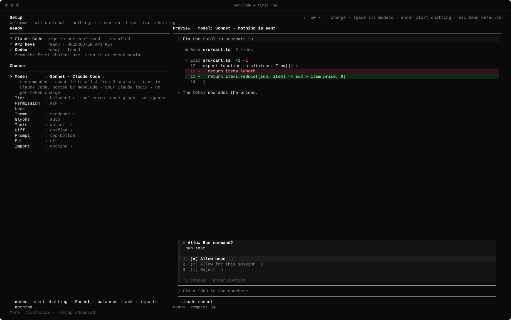
</p>

Replies follow the language of your latest message. `/language Español` (or any language name) fixes it from the next message,
and `/language auto` goes back; every engine gets the choice as one short line with each message
([reply language](docs/prompt-modes.md#reply-language-language)).

<p align="center">
  
</p>

## What it does

### Sessions that outlive the terminal

Sessions live in a daemon, not in the window. Close the terminal and the turn keeps running; open another and it is on screen as
it streams. `mendcode -s <id>`, `--continue` or Ctrl+S attach; a reconnecting terminal replays from the last event it saw, and
`--connect` reaches a daemon on another machine over TLS, where a read-only token only watches ([remote](docs/remote.md),
[sessions](docs/sessions.md)).

`/sessions` lists them by folder, this folder or all projects, with a search row that finds a title, a folder or a pasted id.
`/today` lists what waits for you, the sessions worth picking up and Dream's memory proposals, read-only ([today](docs/today.md)).

<p align="center">
  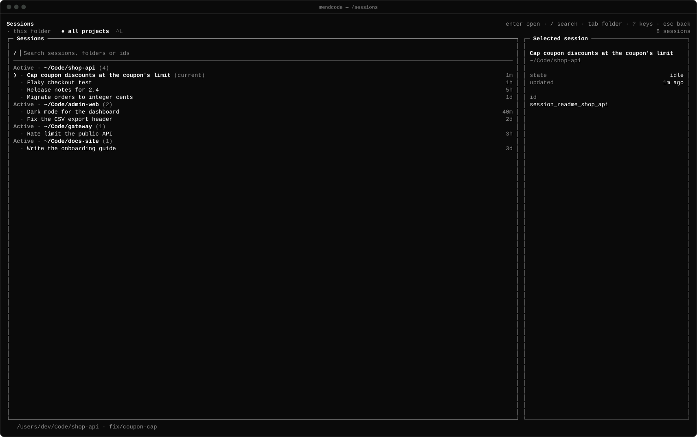
</p>

### Credentials with /env, private chats with /privacy

A `.env` file sits in your checkout as plain text, and only the processes that load it see it. `/env` keeps the same values
in an encrypted vault in MendCode's data directory, outside the repository, and hands them to the agent's shell commands:

| | `.env` in the project | `/env` |
|---|---|---|
| Where it lives | your checkout, plain text | `environment.enc` (AES-256-GCM), its key in `keys/environment.key` |
| Who gets the values | whatever loads the file | the shells MendCode starts for the session, background commands included |
| What the model sees | the file, if a tool reads it | the names only; a printed value comes back as `‹env:NAME›` in the native engine |
| Scope | the folder | session, project (default) or global; session wins over project, project over global |

1. Run `/env`, press `a`, type a name such as `FAKE_API_KEY` and its value. The value field stays hidden.
2. Or paste a whole `.env` on the page: MendCode lists the names only, marks `new`, `replaces existing` or `refused`
   (`PATH`, `NODE_OPTIONS`, `LD_*` and other runtime names), and Enter saves the ones you keep, encrypted. `i` imports a file
   from the project the same way; the file itself is not changed.
3. Ask the agent to run something that needs it. A script reads it as usual: `os.environ["FAKE_API_KEY"]`.

Claude Code, Codex, pi and ACP agents get the same values in the environment of the process MendCode starts for them, but they
print through their own tools, so MendCode cannot mask what they print; `engineEnvironment: false` keeps credentials for the
native engine only. A running process keeps its environment; a change reaches the next one ([environment and privacy](docs/environment-privacy.md)).

<p align="center">
  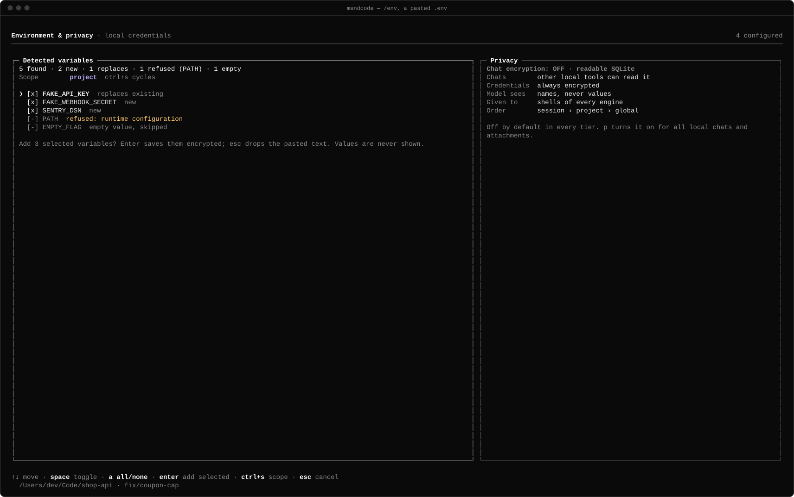
</p>

`/privacy` encrypts your local chats. It is **off by default**; `p` then `y` turns it on. The whole session database (titles,
events, drafts, memories, settings), attachments, compaction transcripts and saved tool outputs become AES-256-GCM files with
the key in `keys/chats.key`, and SQLite runs in memory, so no decrypted copy is written. Turning it off restores plain files
without losing sessions.

- It is encryption **at rest**: it protects a copy of the data without its key. Back up `keys/` separately; a missing key fails
  closed instead of resetting your data.
- Not covered: exports and shares, earlier backups, your checkout (an imported `.env` included), what the providers keep,
  logs owned by Claude Code, Codex or pi, and debug traces you turn on.
- Programs running as you can read the key; it is not a password or a Keychain lock. Encrypted mode keeps the database in RAM
  and rewrites the encrypted file on each write.

<p align="center">
  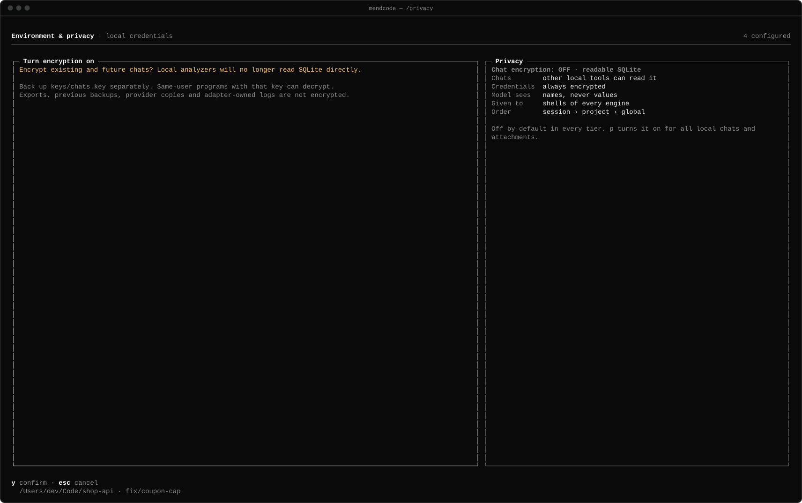
</p>

### Pull request reviews

`/pr review <n>` reviews a pull request with your model. One pass finds candidate defects, a second, independent pass tries to
refute each, and only what it confirms is published as one review with inline comments. Cheap readers on a small model read the
changed code first, so your main model gets their summaries and the hunks that look risky, plus the callers and callees of every
symbol the change touches, from the [code graph](docs/code-graph.md). It uses your `gh` login: no GitHub App,
webhook server or stored token. Nothing is posted until `.mendcode/review.yaml` on the base branch sets `enabled: true`, and
`/pr watch-repo` keeps reviewing new pull requests and pushes. GitLab and Gitea / Forgejo work through adapters
([PR reviewer](docs/pr-review.md), [team setup](docs/pr-review-setup.md)).

### Memory you can read and edit

The agent proposes what to remember; each category has a policy: saved at once, kept for your review, or dropped. A proposal
holding a redacted secret always waits for you. `/memory` approves, edits, pins, rescopes or deletes, and its Graph tab links saved
memories as related, supports, supersedes or conflicts; a memory linked to one that matches the prompt is recalled with it
([memory](docs/memory.md)).

<p align="center">
  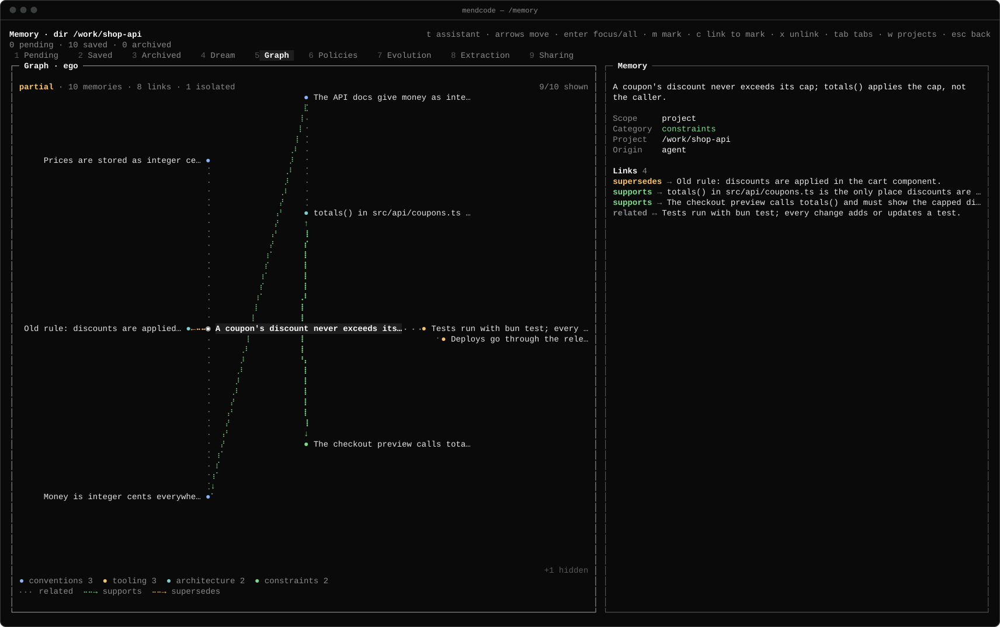
</p>

### Profiles and areas

A profile is a whole setup in one folder: a theme, the terminal settings (logo, home screen, prompt box, density, slash menu,
panel cards), the right panel, keybindings, prompt files and any of the 22 view slots that draw the transcript, plus the skills,
commands, agents, MCP servers and workflows it adds. It is an overlay: nothing is written into your settings, and turning it off
puts everything back. `/profiles` then `o` lists every setting, key and view it takes over, and `k` keeps your own value for one.
`mendcode profile new mylook` writes a complete profile to start from, and anyone installs yours with
`mendcode profile install github:you/mylook` ([profiles](docs/profiles.md)).

`/marketplace` lists the catalogs you turned on, with a search row, a filter by kind (theme, extension, skill, command...) and,
for the selected profile, what installing it takes over and where it comes from. Enter previews before anything installs, and
`d` removes one. `/profiles` and `/marketplace` share three tabs: What it takes over, Installed and Marketplace (`1`, `2`, `3`)
([browse the marketplace](docs/profiles.md#browse-the-marketplace)).

<p align="center">
  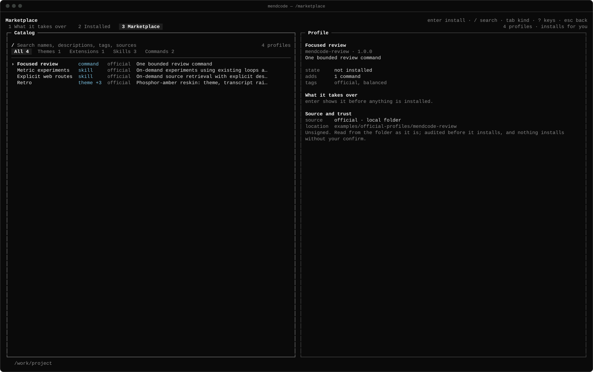
</p>

An area is a set of folders. `mendcode area add company ~/Code/acme` gives everything under it its own user memories, model
roles and default permission; open a terminal there and you are working as `company`, shown as `◆ company` under the prompt.
Everything else is personal ([areas](docs/areas.md)). Your own setup moves to another machine as one checked file
([config bundles](docs/config-bundle.md)).

<p align="center">
  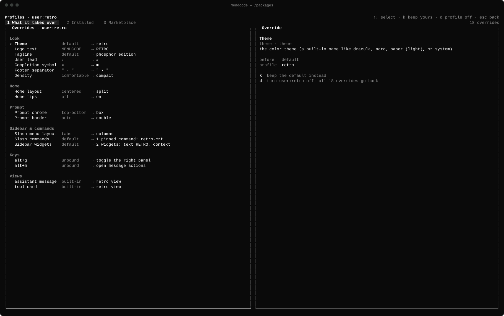
</p>

### Goals, loops and sub-agents

`/goal --budget 200k <objective>` keeps the session taking turns until the objective is met or its token budget runs out. Loops run
an objective on a schedule, with gates and caps. Sub-agents and background tasks are sessions you can open, follow and stop;
fan-out sends one prompt to two to eight models, each in its own worktree, and nothing reaches your checkout until you apply it
([goals](docs/goals.md), [loops](docs/loops.md), [agents](docs/agents.md)).

<p align="center">
  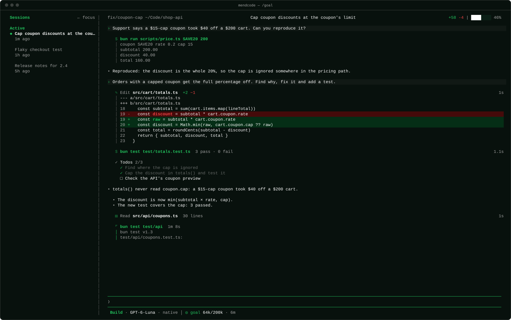
</p>

### Review the diff before you commit

`/changes` lists every file the branch changed with its diff beside it. Comment a line, a selection or a hunk, then send the whole
review back as one message; comments survive reconnects and daemon restarts. Plans get the same treatment: accept, edit, comment
or reject before any code ([changes](docs/changes.md), [plan review](docs/plan-review.md)).

<p align="center">
  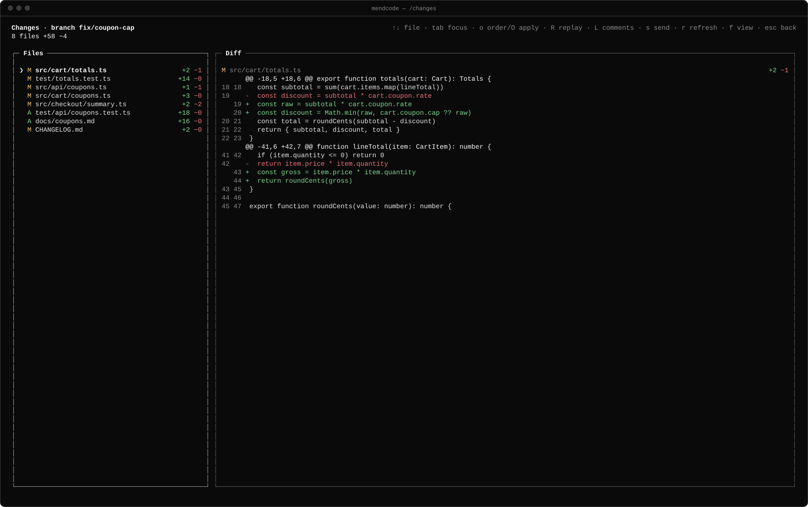
</p>

### One screen, several engines

The native engine runs the models you connect. Claude Code, Codex, ACP agents and pi run behind the same screen, with their own
logins and tool loops, and sub-agents can run on any of them by model name ([engines](#engines)). Around them: a code graph and
language servers for navigation ([code graph](docs/code-graph.md), [LSP](docs/lsp.md)), compaction that packs long conversations
([compaction](docs/compaction.md)), Mermaid diagrams drawn in the terminal ([mermaid](docs/mermaid.md)), native macOS computer use
bound to the window you approve, off until enabled ([computer](docs/computer.md)), a browser tool ([browser](docs/browser.md)),
hooks ([hooks](docs/hooks.md)), push-to-talk dictation ([voice](docs/voice.md)), Telegram
([channels](docs/channels.md)) and usage-limit checkpoints ([usage limits](docs/usage-limit.md)).

## Status

Version 0.x: expect changes between releases, and back up your data before upgrading.

- **Verified on macOS** (Apple silicon): the measurements below and the script-workflow sandbox were run there. The Linux and
  Windows binaries are built and smoke-tested by the release pipeline; the Linux sandbox profile for script workflows has not
  run on real Linux machines yet, and Windows has no script host and no daemon smoke test ([workflows](docs/workflows.md#security-model), [releases](docs/release.md)).
- **Used with real accounts:** Claude Code (daily, with a Claude login), Codex (with a ChatGPT login) and pi (with an OpenAI
  subscription) as engines, and the GitHub pull request reviewer. Their tests also run against fake transports.
- **Tested against fake transports only, not real accounts:** ACP as an engine, the Telegram bridge and MCP OAuth
  ([ACP](docs/acp-engine.md), [channels](docs/channels.md), [MCP OAuth](docs/mcp-oauth.md)).
- **Your data:** `--dir`, else `MENDCODE_DIR`, else `~/.mendcode`. To back it up, quit every terminal, run
  `mendcode daemon stop` and copy the whole directory (the database with its `-wal` and `-shm` files, `blobs/`, and `keys/`, which
  the encrypted secrets need) ([storage](docs/storage.md), [secrets](docs/secrets.md)).

## Build from source

With Bun (CI pins 1.3.13) and the pinned pnpm 11.17.0 ([package.json](package.json)):

```sh
pnpm install --frozen-lockfile --config.minimumReleaseAge=10080
bun apps/cli/src/entry.ts --dir "$(mktemp -d)"   # disposable data; reuse a --dir to keep sessions
bun run build                                    # dist/mendcode for this machine (--target, --outfile)
```

`sh scripts/install-dev.sh` installs a `mendcode` wrapper in `~/.local/bin` that runs the checkout. Releases: pushing a `v*`
tag runs [release.yml](.github/workflows/release.yml), which runs the whole test gate, builds the five binaries (macOS and Linux
x64/arm64, Windows x64), signs them with keyless cosign, attests them and attaches an SBOM; [nightly.yml](.github/workflows/nightly.yml)
tags `main` once a day when it changed. There is no Apple notarization or Windows code signing yet ([releases](docs/release.md)).
To program MendCode from a stable MendCode and try the change in a second daemon that restarts alone, use [`mendcode dev`](docs/dev-mode.md).
See [CONTRIBUTING.md](CONTRIBUTING.md) to send a change.

## Replaceable views

Every terminal surface is drawn through one of 22 view slots, and the built-in look uses the same contract ([views](docs/views.md)):

- Transcript: `message.user`, `message.assistant`, `message.reasoning`, `tool.card`, `tool.row`, `compaction.card`, `turn.status`.
- Prompt area: `approval`, `question`, `prompt.frame`, `bar`.
- Chrome: `topbar`, `footer`, `notice`, `home`, `sessions.sidebar`, `panel.widget`, `slash.menu`.
- Pages and overlays: `page`, `page.status`, `overlay`.

Not replaceable: the prompt editor, the tasks and scratchpad dock, and the live compaction panel (their frame and surroundings are slots). Page bodies reach a view already drawn: a view restyles the rows, there is no typed model per page. Views are synchronous and data-only, keys and approvals stay with the terminal, and a view that throws or runs over 4 ms is replaced by the built-in. **Views run in the terminal process with your permissions and are not sandboxed**; installing one is trusting its author. Project views need a trusted project; remote and `--safe-mode` terminals load none. Start with `mendcode view scaffold <slot>`.

## Script workflows

A script workflow is a short JavaScript program that decides at run time which agents to start; static JSON plans work as before ([workflows](docs/workflows.md#script-workflows), [examples](examples/workflows)). Tier: balanced and full.

- **API:** `agent`, `parallel`, `pipeline`, `check`, `ask`, `merge`, `memo`, `phase`, `log`, `sleep`, `args`, with a literal `export const meta` for name, phases, budget and completion contract. Start with `/workflows run`, `workflow run` or the `workflow_script` tool, which asks before every start.
- **Journal and resume:** every call is journaled. After a daemon restart or `resume`, finished calls replay from the journal and are not run again; tested by killing a real daemon mid-run.
- **Budgets:** `agents`, `tokens`, `usd`, `minutes`. A cap pauses the run; `workflow budget` raises it and `resume` continues.
- **Per agent:** `engine`, `model` and `effort` are checked before any session starts. Engines other than native need the full tier and an exact model.
- **`merge`:** combines the branches of `worktree` agents on an integration branch for review; nothing is merged into your checkout without an explicit `apply` approval.
- **Isolation:** the script runs in a separate OS-sandboxed process with a stripped scope, a watchdog and a memory limit, never in the daemon. Verified on macOS (Seatbelt); the Linux bubblewrap profile is not yet verified; Windows has no script host.

## Markdown renderer

The `full` message renderer (balanced and full views) draws code blocks with a language header and a `copy` button (click, or `ctrl+x Y` for the block nearest the middle of the screen), four table styles (`box`, `rules`, `grid`, `minimal`), four heading styles (`banner`, `bold`, `underline`, `uppercase`), `> [!NOTE]`-style callouts, task lists and footnotes. 28 colour slots can be overridden one by one with `markdownColors` or a theme file. `markdownCopyHints` (`auto`, `code`, `all`, `off`) chooses which blocks show a visible `copy`. Limits: right-to-left text is reordered per paragraph, heading, list item and quote, not with full bidi (no isolates or embeddings, no Arabic shaping), and tables and code stay left-to-right. The minimal view and the `markdown` and `plain` renderers keep the classic look. See [markdown design](docs/design/markdown-parity.md) and [customization](docs/customize.md).

## Process modes

`processMode` (`--process`, `MENDCODE_PROCESS`) is `auto` by default in every tier (same as `solo`): the terminal hosts the daemon in its own process and hands it to a detached daemon when something needs one, such as a second terminal or standing work. `daemon` keeps the terminal and the daemon as two processes. The trade-off, as the [design](docs/design/memory-single-process.md) states it: less RAM, a hard-killed terminal interrupts its running turn, slower first frame. Measured with the real CLI in a pseudo-terminal, empty session: 124 MB against 167 MB (see [measurements](#measurements)), first frame 194 ms against 105 ms with a daemon already running (load 2.4 to 2.7). Run `bun scripts/perf.ts --mode daemon,solo` to repeat it ([performance](docs/performance.md)).

## Terminal details

- **Memory notices:** each memory write is one muted transcript row (`Memory saved · project · "…"`) with a `/memory undo` hint, or a one-line toast when the write is not in the visible transcript. `/memory undo` deletes the newest memory this session saved, and again the one before; edits and removals are not undone ([memory](docs/memory.md#memory-consent-and-notices)).
- **Prompt history:** up and down arrows recall sent messages, commands, `!` shell lines and discarded drafts, per project; `alt+r` or `/prompt-history` searches them by kind. Text that leaves the prompt unsent (12 or more characters, or several lines) is kept as a draft ([editor](docs/editor.md#discarded-drafts)).
- **Slash menu layouts:** `tabs` (default), `groups`, `columns`, `flat`; minimalist defaults to `flat` ([customization](docs/customize.md)).
- **Right panel:** `/panel` opens the `pulse` cards; presets are `pulse`, `crew`, `ledger`, `focus`, `full` and `galaxy` (full tier only). Balanced and full tiers ([panel](docs/sidebar.md)).
- **Empty sessions:** a new chat reuses the project's empty session, so there is at most one per project ([sessions](docs/sessions.md#empty-chats)).

## Tiers

Use `/tier minimalist`, `/tier balanced` or `/tier full`. Minimalist selects compact presentation and a minimal prompt; balanced selects comfortable presentation and a focused prompt; full selects the full prompt. [Tiers](docs/tiers.md) are separate from setup presets.

Every notice is one row in words: a severity mark, the message and a hint; F4 opens the full text, and an error stays until your
next prompt or command. A command your tier does not list, typed by hand, runs nothing and answers that way with the tier that
has it: `/review · balanced · /tier balanced`.

<p align="center">
  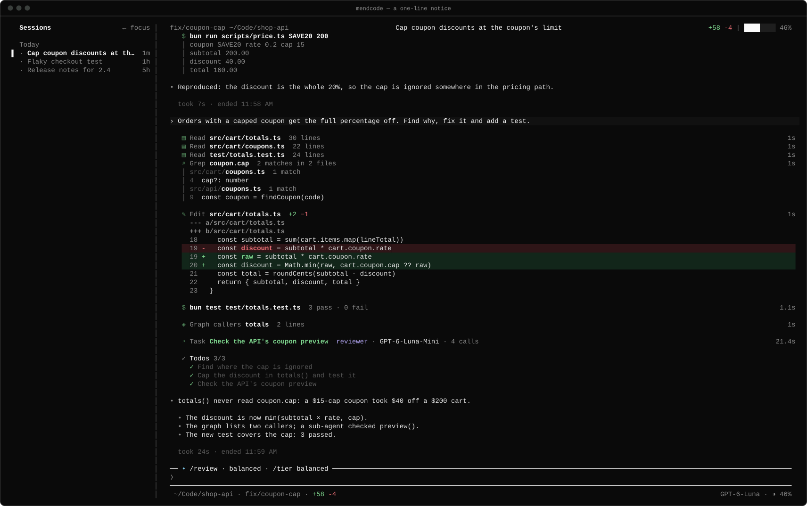
</p>

Included means the tier enables the feature, subject to its own controls. Opt-in means the tier permits it but an explicit switch/action is still required. Kernel features are independent of tiers, with their own disabling controls and safe-mode restrictions. `/tier <feature> on|off|default` overrides non-kernel features; `--safe-mode` remains a ceiling. With no tier selected, legacy defaults apply.

Generated from [tier-data.ts](packages/protocol/src/tier-data.ts), including every manifest feature. Print the block with `bun scripts/readme-tiers.ts`; verify with `bun scripts/readme-tiers.ts --check` or `bun test scripts/readme-tiers.test.ts`.

<!-- tiers:start -->
| Feature | Minimalist | Balanced | Full | Own switch / action |
|---|---|---|---|---|
| [Slash menu layouts](docs/customize.md) (`slash_menu`) | Kernel | Kernel | Kernel | /customize · slashMenu · slashCommands (minimalist lists 21 commands, flat) |
| [Extensions](docs/extensions.md) (`extensions`) | Kernel | Kernel | Kernel | MENDCODE_EXTENSIONS=0 · --pure |
| [Installed profiles](docs/profiles.md) (`profiles`) | Kernel | Kernel | Kernel | disabledProfiles · /marketplace |
| [Profile chat tools](docs/profiles.md) (`profile_tools`) | — | Included | Included | features.profile_tools |
| [Shell hooks](docs/hooks.md) (`hooks`) | Kernel | Kernel | Kernel | MENDCODE_HOOKS=0 |
| [MCP servers](docs/mcp-oauth.md) (`mcp`) | — | — | Included | mcp.json |
| [Code graph tools](docs/code-graph.md) (`codegraph`) | — | Included | Included | MENDCODE_CODEGRAPH=0 |
| [Sub-agents (task)](docs/agents.md) (`subagents`) | — | Included | Included | tools.task |
| [Script workflows](docs/workflows.md) (`script_workflows`) | — | Included | Included | tools.workflow_script |
| [Adaptive reasoning (JEV)](docs/reasoning.md) (`jev`) | — | — | Included | experimental.reasoning_auto |
| [Pet companion](docs/customize.md) (`pets`) | — | — | Included | pet |
| [Experimental pet generator](docs/customize.md) (`pet_generator`) | — | — | Opt-in | /pet new (explicit confirmation) |
| [Voice dictation](docs/voice.md) (`voice`) | — | — | Opt-in | voice.enabled |
| [Computer control](docs/computer.md) (`computer`) | — | Opt-in | Opt-in | /tier computer on (macOS; off until then) |
| [Headless browser](docs/browser.md) (`browser`) | — | — | Opt-in | MENDCODE_BROWSER=1 · MENDCODE_BROWSER_EXTENSION=1 |
| [Code Mode](docs/code-mode.md) (`code_mode`) | — | — | Opt-in | experimental.code_mode |
| [Snip stale output](docs/compaction.md) (`snip`) | — | — | Opt-in | experimental.snip |
| [Worktree tool](docs/worktrees.md) (`worktree_tool`) | — | — | Opt-in | experimental.worktree_tool |
| [Auto-resume at usage limit](docs/usage-limit.md) (`usage_resume`) | Included | Included | Included | /limit cancel |
| [Thread tools](docs/sessions.md) (`threads`) | — | Included | Included | experimental.thread_tools |
| [PR watch](docs/pr-watch.md) (`pr_watch`) | — | Opt-in | Opt-in | experimental.pr_watch |
| [PR reviewer](docs/pr-review.md) (`pr_review`) | — | Opt-in | Opt-in | experimental.pr_review |
| [Command output filters](docs/advanced-config.md) (`output_filters`) | — | Included | Included | tool_output.filters |
| [Context forecast](docs/layout.md) (`forecast`) | — | Included | Included | /footer +forecast |
| [pi engine (RPC)](docs/pi-engine.md) (`pi`) | — | — | Opt-in | pi.json · /tier pi on |
| [Thread MCP bridge](docs/thread-mcp.md) (`thread_mcp`) | — | — | Opt-in | /tier thread_mcp on claude\|codex\|acp:&lt;name&gt; |
| [Codex as its own harness](docs/setup.md) (`codex_engine`) | Opt-in | Opt-in | Opt-in | /tier codex_engine on · /setup's Codex row |
| [ACP registry](docs/acp-engine.md) (`acp_registry`) | — | — | Included | /tier acp_registry on |
| [Lossless storage compaction](docs/storage.md) (`storage_compact`) | Opt-in | Opt-in | Opt-in | storage --compact --offline --dir DATA |
| [Suggested review order](docs/changes.md) (`review_order`) | — | Included | Included | /changes · o preview · O apply |
| [Session lifecycle](docs/sessions.md) (`session_meta`) | — | Included | Included | /tier session_meta on |
| [Fan-out comparison](docs/agents.md) (`fanout`) | — | — | Included | /tier fanout on |
| [Pre-limit checkpoint](docs/usage-limit.md) (`limit_checkpoint`) | — | Included | Included | /tier limit_checkpoint off |
| [Graph orientation and impact](docs/code-graph.md) (`graph_context`) | — | Opt-in | Opt-in | /tier graph_context on (off until then: the model calls the graph tools itself) |
| [Focused session handoff](docs/sessions.md) (`handoff`) | — | Included | Included | /handoff &lt;goal&gt; |
| [Instruction includes](docs/prompt-modes.md) (`instruction_includes`) | — | Included | Included | @relative/path in AGENTS.md |
| [Profile capability preview](docs/profiles.md) (`profile_capabilities`) | — | Included | Included | /marketplace preview |
| [Caveman prose style](docs/prompt-modes.md) (`caveman`) | — | Opt-in | Opt-in | /output-style caveman |
| [PDF and repository fetch](docs/tools-web.md) (`webfetch_modes`) | — | Opt-in | Opt-in | webfetch mode |
| [Deferred MCP tools](docs/tool-discovery.md) (`tool_discovery`) | — | — | Included | experimental.tool_discovery |
| [Official profile kit](docs/profiles.md) (`official_profiles`) | — | Opt-in | Opt-in | Explicit local catalog install |
| [Durable orchestration receipts](docs/thread-mcp.md) (`orchestration_receipts`) | Kernel | Kernel | Kernel | clientRequestId on thread mutations |
| [Metric experiments](docs/loops.md) (`autoresearch`) | — | — | Opt-in | On-demand metric-experiment skill |
| [Explicit web routes](docs/tools-web.md) (`web_routing`) | — | Opt-in | Opt-in | On-demand explicit-web skill |
| [Session panel cards](docs/sidebar.md) (`panel`) | — | Opt-in | Opt-in | /panel |
| [Session galaxy](docs/sidebar.md) (`panel_orbit`) | — | — | Opt-in | /panel galaxy |
| [Panel model tokens](docs/sidebar.md) (`panel_models`) | — | Opt-in | Opt-in | /panel ledger |
| [File viewer (click a path)](docs/file-viewer.md) (`file_viewer`) | — | Included | Included | /customize · pathClick · /open |
| [Memory consent and management](docs/memory.md) (`memory_ux`) | Kernel | Kernel | Kernel | memoryEnabled · memoryRequireApproval · /memory |
| [One process per terminal (solo)](docs/design/memory-single-process.md) (`single_process`) | Kernel | Kernel | Kernel | /customize · processMode · --process (auto in every tier: one process while one terminal is open, less RAM; a second client moves the daemon to its own process; solo keeps it in the terminal; daemon keeps the separate process) |
| [Lean tool catalogue](docs/tool-discovery.md) (`lean_tools`) | Included | Included | Included | /tier lean_tools off |
| [Auxiliary tools in every request](docs/tool-discovery.md) (`aux_tools`) | — | Opt-in | Opt-in | /tier aux_tools on |
| [MendCode tools inside Claude Code](docs/claude-code.md) (`harness_tools`) | — | Included | Included | /tier harness_tools on |
| [Plan and goal tools in every request](docs/tool-discovery.md) (`plan_tools`) | — | — | Opt-in | /tier plan_tools on |
| [glob and grep in every request](docs/tool-discovery.md) (`find_tools`) | Included | Included | Included | /tier find_tools off |
| [Screen settings tool in every request](docs/tool-discovery.md) (`ui_tool`) | — | Included | Included | /tier ui_tool on |
| [Orientation block in the first message](docs/tool-discovery.md) (`orientation`) | — | Included | Included | /tier orientation off |
| [Git page (review, commit, worktrees)](docs/git.md) (`git_hub`) | — | Included | Included | /git · git.defaultTab |
| [Git page push and pull request](docs/git.md) (`git_actions`) | — | Opt-in | Opt-in | experimental.git_actions |
| [Quota refresh probe](docs/usage-limit.md) (`quota_refresh`) | Opt-in | Opt-in | Opt-in | /customize · quotaRefresh (off until a provider is listed; each probe spends some of the quota it measures) |
| [Compact while idle](docs/compaction.md) (`idle_compact`) | — | — | Included | /tier idle_compact off · /settings · idle compact |
| [1h cache after long waits](docs/prompt-cache.md) (`wait_cache`) | — | — | Included | /tier wait_cache off · /settings · cache ttl |
| [Notice before a compaction](docs/compaction.md) (`compact_notice`) | — | Included | Included | /tier compact_notice off · /settings · compact notice |
| [Project backlog](docs/sidebar.md) (`backlog`) | — | — | Included | /tier backlog off · /backlog · /panel widget backlog |
| [Sub-agent worktrees](docs/agents.md) (`task_worktree`) | — | — | Included | /tier task_worktree off · task isolation: "worktree" |
| [Sub-agent forks (parent's cached context)](docs/agents.md) (`task_fork`) | — | — | Opt-in | /tier task_fork on · task fork: true |
| [Bare sub-agents (no instructions, memories or skills)](docs/agents.md) (`task_bare`) | — | Opt-in | Opt-in | /tier task_bare on · task bare: true |
| [Sub-agents on a cheaper model](docs/agents.md) (`cheap_subagents`) | — | Included | Included | /tier cheap_subagents off · /model roles · subagent |
| [Claude Code compacts at MendCode's point](docs/claude-code.md) (`claude_compact`) | — | Included | Included | /tier claude_compact off · compactAtTokens |
| [Cache countdown (footer)](docs/layout.md) (`cache_countdown`) | — | — | Opt-in | /footer +warm |
| [One tree: sessions sharing a checkout](docs/one-tree.md) (`one_tree`) | — | Included | Included | /tier one_tree off |
| [Advisor model](docs/advisor.md) (`advisor`) | — | Opt-in | Opt-in | /advisor &lt;model&gt; |
| [Visible plan (todo and its guidance)](docs/layout.md) (`visible_plan`) | — | Included | Included | /tier visible_plan off |
| [Code graph autopilot](docs/code-graph.md) (`graph_autopilot`) | — | — | Included | /tier graph_autopilot on\|off (on by default in nightly, dev and local builds only) |
| [Automatic memory (use, selective review; nightly consolidation in full)](docs/memory.md) (`memory_auto`) | — | Included | Included | /tier memory_auto off · memoryUse · memoryGenerate · memoryRequireApproval · memoryReviewEveryTurns · memoryReviewDailyCap · dreamConsolidationPolicy in full (a switch you set wins) |
| [Resume note in a new chat](docs/memory.md) (`resume_context`) | — | — | Included | /tier resume_context off |
| [Plans kept as Markdown files](docs/plan-review.md) (`plan_files`) | — | Included | Included | /tier plan_files off · plan_files_location |
| [Claude message threads](docs/message-threads.md) (`message_threads`) | Included | Included | Included | /tier message_threads off · zeroDataRetention |
| [What's new for you](docs/whats-new.md) (`whats_new`) | — | Included | Included | /whatsnew · /whatsnew all · /tier whats_new off |
<!-- tiers:end -->

## Measurements

Measured 2026-11-02 on a MacBook Pro (Mac16,8), Apple M4 Pro, 24 GB RAM, macOS 27.0 (26A428), Bun 1.3.13, arm64; source revision `b482241f`. Synthetic offline workloads, temporary stores and HOME, no real providers or other coding tools, except the two real-CLI rows. Load average 5–6 (shared machine, not repeated on an idle one).

| Measure | Result | Method |
|---|---|---|
| Compiled CLI `help` startup | 59.3 ms | `compiledTarget` + `measureCliStartup` from [perf.ts](scripts/perf.ts) |
| Bytes per session, 60-session batch | 154,283 | Rounded batch total / 60 after checkpoint, compression and sharing |
| Bytes for 2,000 sessions | 235,356,160 (224.5 MiB) | Database + WAL + blobs after checkpoint; 117,678 bytes/session rounded |
| Real CLI, one process: at the prompt / after a first reply | 129–131 / 138–140 MB RSS, 63–64 / 66–69 MB physical footprint | Compiled build in a pseudo-terminal 160×45, clean HOME with only the login copied, minimalist, balanced and full tiers, one read-only question on gpt-6-luna, the prompt after 12 s, three launches each (pi the same way: 133 / 139 MB RSS, 81 / 88 MB footprint) |
| Real session on disk | 2.5–2.6 KB | Same run: every stored byte of that session's rows plus its session row, read after the daemon's idle step (pi: 2.8–2.9 KB session file) |
| Daemon RSS, idle / with a client attached | 95–98 MB / 119–130 MB | `bun scripts/perf.ts --mode daemon,solo`, compiled daemon, 0 / 1,000 / 10,000 messages |
| Client RSS, idle / after scrolling and streaming | 66–74 MB / 131–165 MB | Same run, compiled client |
| First frame | 163 ms / 198 ms / 220 ms | Same run, `daemon` mode, 0 / 1,000 / 10,000 messages |
| Scroll frame p95 | 3.5 ms / 5.6 ms / 5.3 ms | Same run |
| Streaming frame p95 | 5.3 ms / 7.4 ms / 7.3 ms | Same run |
| One process (`processMode: auto`, the default in every tier, or `solo`; `daemon` keeps two processes and is what the rows above measure), RSS idle / after use | 128 / 220 MB (0 messages), 145 / 305 MB (10,000) | Same run; this rig starts the process without the launcher's compile options, so it reads higher than the real-CLI row. [Design](docs/design/memory-single-process.md) |
| One process, frame p95, scroll / stream | 1.7 to 8.4 ms / 2.3 to 3.0 ms | Same run as the one-process RSS row |
| One process, first frame | 304 ms / 323 ms / 342 ms | Same run as the one-process RSS row, 0 / 1,000 / 10,000 messages ([performance](docs/performance.md#solo-mode-one-process)) |

Disk command: `MEND_DISK_REPORT=1 bun test packages/store/test/disk-budget.test.ts` (5 passed). Each [synthetic session](packages/store/test/synthetic-data.ts) has eight turns, three tool calls/turn, streamed text, model history and file snapshots. Batch sizes share different amounts of data; these are not predictions for arbitrary transcripts or Git worktrees. The [disk test](packages/store/test/disk-budget.test.ts) enforces 210 KiB/session for the small batch and 350 MiB for 2,000 sessions. See [storage](docs/storage.md).

[Performance](docs/performance.md) documents `bun scripts/perf.ts`: compiled client and daemon, faux engine, 0/1,000/10,000 messages, RSS, startup and frame p95. The [budget rules](scripts/perf-budgets.ts) and [tests](scripts/perf.test.ts) fail on regression. Numbers vary with machine load; no historical or competitor measurements are presented here.

## Engines

| Engine | Transport / requirements | Reference |
|---|---|---|
| Native | Built-in model loop; configured providers | [Providers](docs/providers.md) |
| Claude Code | Installed, logged-in `claude`; stream-json | [Claude Code](docs/claude-code.md) |
| Codex | Installed, logged-in `codex`; app-server | [Engine tests](packages/engine-codex/test/engine.test.ts), [thread bridge](docs/thread-mcp.md) |
| ACP | Explicitly configured external ACP agent | [ACP](docs/acp-engine.md) |
| pi | Installed, logged-in pi; RPC; opt-in, full-tier permission | [pi](docs/pi-engine.md) |

External engines retain their own authentication and tool loops. Claude Code, Codex and pi have run with real accounts; ACP is covered only by fake transports so far.
## Embedding

`mendcode app-server --dir DATA --cwd PROJECT` exposes local JSONL JSON-RPC (`mendcode-app-server@1`): threads, turns, events and approval requests. A typed client is exported by `@mendcode/client/app-server`. Headless `run --format json`, the daemon socket and opt-in HTTP adapter are alternatives. See [embedding](docs/embedding.md) and its [client example](examples/app-server-client.ts).

## Security model

- The daemon applies permission modes and approval rules before tools execute ([permissions](docs/permissions.md)).
- OS sandboxing is opt-in and off by default; approval alone is not confinement ([sandbox](docs/sandbox.md)).
- Remote/peer access is scoped; local-data commands and host execution settings have local-only guards ([remote](docs/remote.md), [audit](docs/security-2026-10-04.md)).
- Recognized pasted secrets become markers with encrypted values; detection does not certify arbitrary text or external-engine files ([secrets](docs/secrets.md), [audit](docs/security-2026-10-04.md)).
- `/env` credentials are always stored encrypted and the model gets their names, not their values; `/privacy` encryption of local chats is opt-in and at rest only ([environment and privacy](docs/environment-privacy.md)).
- The thread MCP bridge is opt-in per engine, project-scoped and short-lived, with normal approvals and no user-config rewrites ([thread MCP](docs/thread-mcp.md)).

## Docs and development

[Commands](docs/commands.md) · [Customization](docs/customize.md) · [Views](docs/views.md) · [Workflows](docs/workflows.md) · [Memory](docs/memory.md) · [Compaction](docs/compaction.md) · [Worktrees](docs/worktrees.md) · [Profiles](docs/profiles.md) · [Usage limits](docs/usage-limit.md) · [Upgrade](docs/upgrade.md) · [Uninstall](docs/uninstall.md) · [Migrating from the legacy MendCode](docs/migrate-v1.md)

```sh
bun test scripts/readme-tiers.test.ts apps/cli/test/footprint.test.ts apps/cli/test/tui-automation.test.ts
./node_modules/.bin/tsc -p tsconfig.base.json --noEmit
```

## License

MendCode is open source under the [Apache License 2.0](LICENSE). Anyone who copies or builds on it must keep the [NOTICE](NOTICE) that credits MendCode and its author, and say what they changed. Versions released before 2026-11-06 stay under the MIT license they shipped with.

The MendCode name and logo are not licensed: forks must use their own name and logo.

Dependency notices: [THIRD_PARTY.md](THIRD_PARTY.md).
