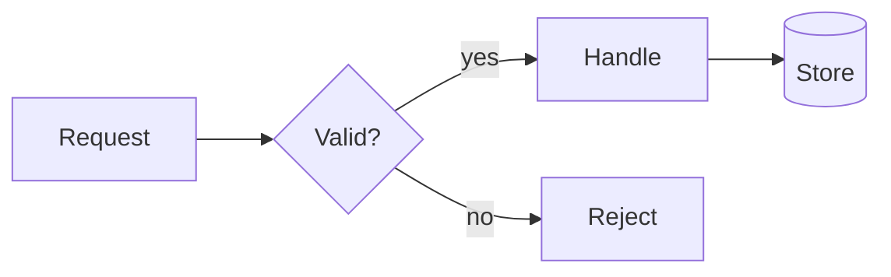
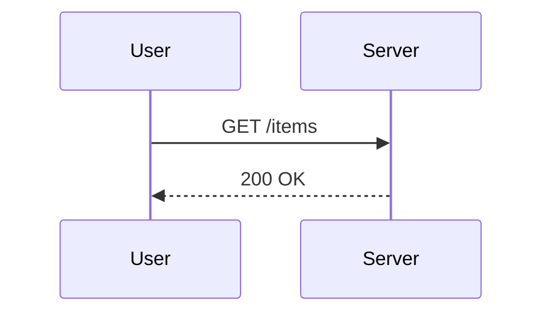
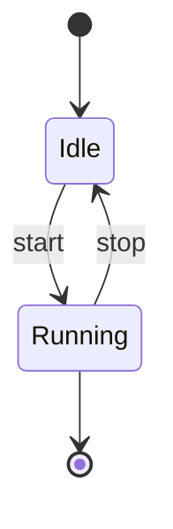
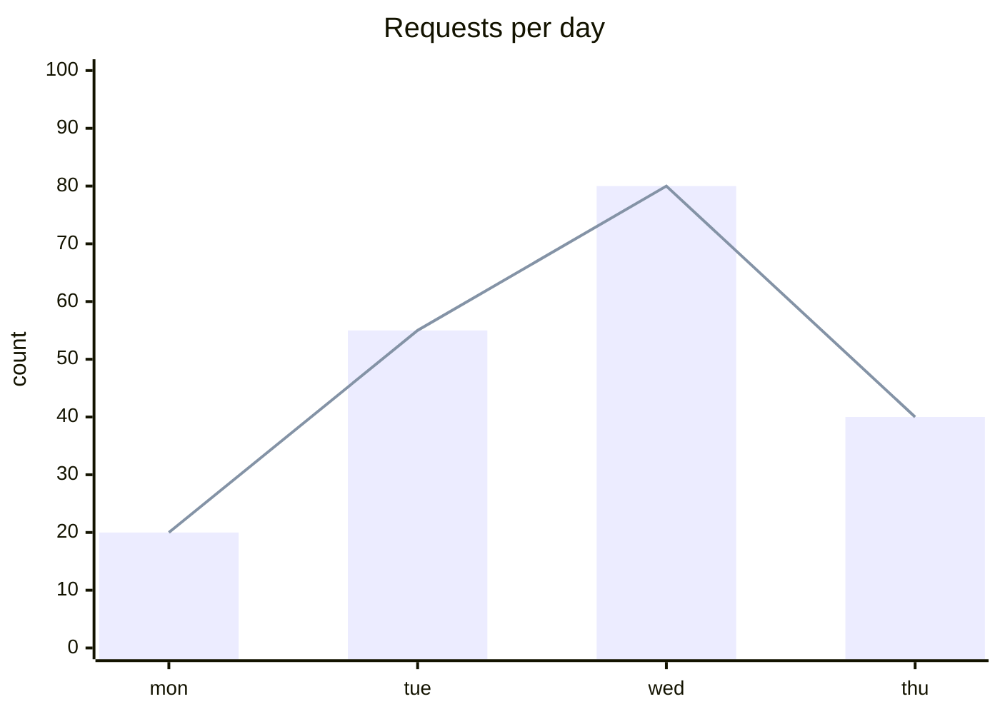

# Release notes for 2.4

## Overview

### Highlights

#### Details

##### Fine print

###### Footnotes of footnotes

A paragraph with **bold**, *italic*, ~~strikethrough~~, `inline code`, a [named link](https://example.com/docs) and a bare https://example.com/path/to/a/very/long/address that wraps. Colors like #ff8800 get a swatch. A footnote reference[^1] sits in the text.

[^1]: The footnote body explains the reference.

> A plain quote that continues
> on a second line.
>
> > A nested quote.

> [!NOTE]
> Callouts carry a label and a colored rail.

> [!WARNING]
> Check the migration before upgrading.

- Top level item
  - Nested item with `code`
    - Third level
- [x] Finished task
- [ ] Open task

1. First step
2. Second step
   1. Sub step

| Name | Qty | Note |
|:-----|----:|:----:|
| apple | 3 | fresh **fruit** |
| kiwi | 12 | `green` |

| 名前 | 説明 | Status |
|---|---|---|
| 猫 | とても長い説明文がここに入ります | ✅ done |
| 🚀 launch | 発射 | pending |

| id | service | region | owner | latency p50 | latency p99 | errors | status |
|----|---------|--------|-------|-------------|-------------|--------|--------|
| 1 | gateway | us-east-1 | platform | 12 ms | 88 ms | 0.01% | healthy |
| 2 | billing | eu-west-2 | payments | 31 ms | 240 ms | 0.20% | degraded |

```ts
// Sum the totals
export async function total(items: Item[]): Promise<number> {
  const label = "total"
  return items.reduce((sum, item) => sum + item.price * 2, 0)
}
```

```bash
$ git commit -m "fix: handle empty input" --no-verify # skip hooks
$ for f in *.ts; do echo "$f" | wc -l; done
```

```diff
--- a/src/app.ts
+++ b/src/app.ts
@@ -1,3 +1,3 @@
 const a = 1
-const b = 2
+const b = 3
```

```yaml
name: ci
on: [push]
jobs:
  test:
    runs-on: ubuntu-latest
    steps:
      - run: bun test
```

```python
def greet(name: str) -> str:
    return f"hello {name}"  # greet
```

```text
A very long line of plain code that is certainly wider than the viewport and must wrap with a continuation marker instead of breaking the frame at any width.
```

---









שלום עולם, זו פסקה בעברית עם מילה באנגלית כמו MendCode ומספר 2024 באמצע המשפט.

مرحبا بالعالم، هذه فقرة بالعربية مع كلمة MendCode ورقم 42 داخل الجملة.

- פריט ראשון ברשימה
- פריט שני with English

<details>
<summary>Collapsed details</summary>

Hidden **content** inside.

</details>

Final paragraph after everything.
