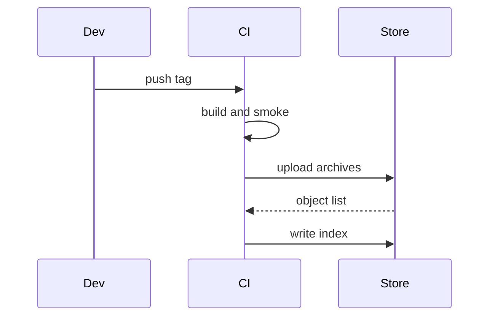

# Release pipeline rewrite

> [!NOTE]
> Private notes are not part of this plan. Every name below is invented for the fixture.

## 1. Context

The release job runs five stages in one script. A failure in the packaging stage re-runs the whole job, so a flaky upload costs twenty minutes. The plan splits the stages and keeps each one retryable.

- Keep the existing tag format.
- Do not change the install script.
- Measure the job before and after.

## 2. Flow


## 3. Stages

| Stage | Input | Output | Retry | Owner |
| --- | --- | --- | --- | --- |
| Resolve | tag name | version, channel | none | release |
| Build | version | one binary per platform | whole stage | build |
| Smoke | binaries | pass or fail per platform | per platform | build |
| Package | binaries | archives, checksums | whole stage | release |
| Upload | archives | store objects | per object | release |
| Publish | store objects | index file | none | release |

> [!WARNING]
> The publish stage is the only one that cannot be retried; it runs last and only when every earlier stage passed.

## 4. Steps

1. Split `scripts/release.sh` into one script per stage under `scripts/release/`.
2. Give each stage a cache key made of the version and the input checksums.
3. Add a retry wrapper that re-runs only the failed unit, up to three times.
4. Write the index only after the upload stage lists every object.
5. Add a dry-run flag that prints what each stage would do.

## 5. Order of work



## 6. Risks

| Risk | Likelihood | Mitigation |
| --- | --- | --- |
| Cache key collides across channels | low | Include the channel in the key |
| Partial upload leaves a stale index | medium | Index is written last, from the listing |
| Retry hides a real failure | medium | Count retries and fail the job above three |

## 7. Verification

Run the stages locally with the dry-run flag, then on a throwaway tag. Compare the job time with the last ten releases.

```sh
scripts/release/run.sh --dry-run --tag v0.0.0-test
```

## 8. Rollback

Delete the throwaway tag and its store objects. The old script stays in the tree until two real releases pass.

