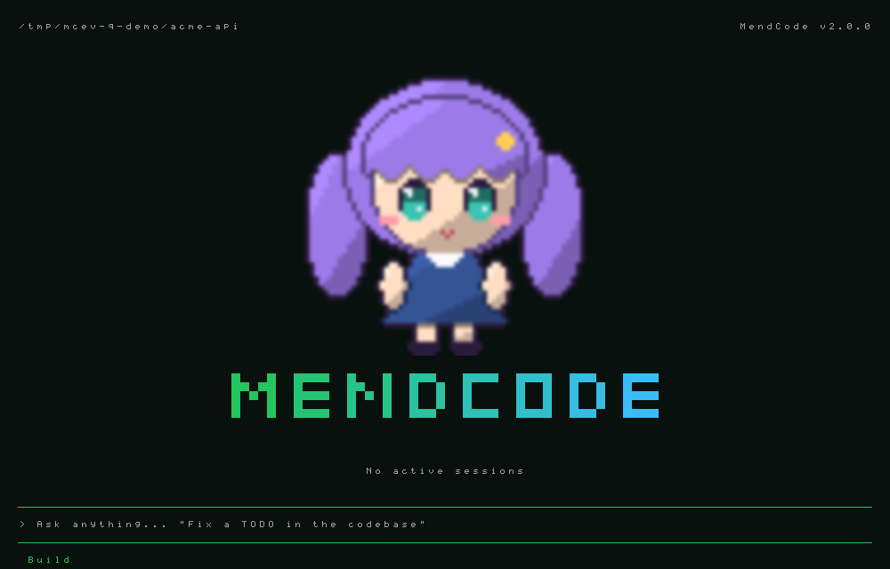
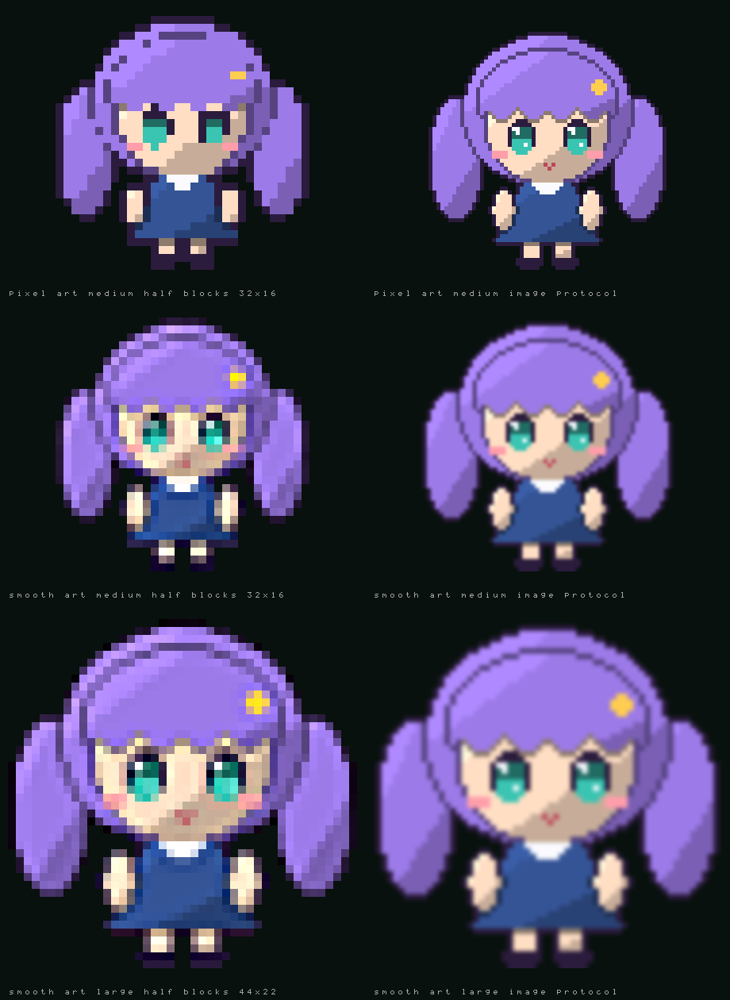
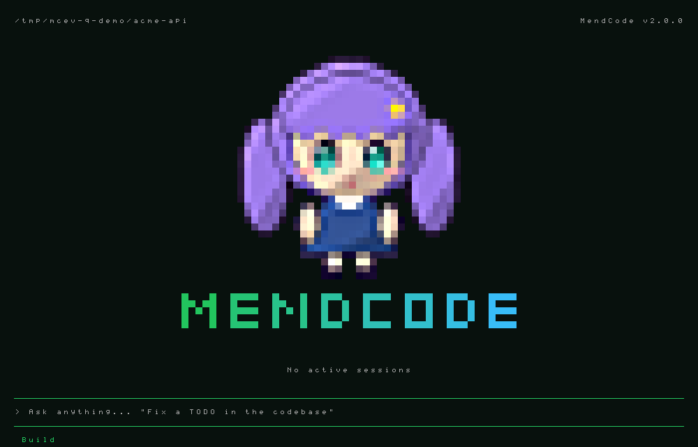

# Customize, settings, status and extensions pages

Four in-terminal pages, all opened with a slash command. Terminal choices also have a daemon-backed automation interface.

| Command | What it does |
|---|---|
| `/customize` | Edit the terminal's look with a live preview; every change is saved at once. |
| `/settings` | Every daemon setting, grouped, plus links to `/customize` and `/extensions`. |
| `/status` | Read-only facts: daemon, engines, session, MCP, extensions, storage, versions. |
| `/extensions` | What the daemon and this terminal loaded, with errors; trust the project's extensions. |

A package that carries a look (a theme, profile values, keys, views) applies as an overlay on what `/customize` stores: the page shows the value in force, a change you make to a key the package holds is yours from then on (kept in `<data dir>/activation.json`), and turning the package off puts your stored values back. `/packages` then `o` lists what a package currently overrides and `p` the precedence report. See [packages](packages.md#how-activation-works-an-overlay-never-an-edit).

## /customize

Slash menu: `tabs` (default), `groups`, `columns`, or `flat`. Minimalist inherits compact
`flat` until a layout is saved; applying a tier sets its default again. Tabs open on recent:
pins, the last four used, the eight most used, then essentials. With no recents or visible pins,
six useful commands appear under `suggested`. A typed query (`/s`) lists the best matches first and,
among equally good ones, the commands used before, the most used ahead (then the most recent); an exact
name or alias still comes first. Recents store only
canonical names, counts and last-use times in `<dataDir>/tui/slash-recents.json` (128 entries).
Remote terminals do not access that file.

The fixed groups are `recent session context code agents setup look more`. Tab/Shift+Tab or
left/right change the tab or column; up/down select; Enter runs (commands needing arguments
complete into the prompt). Groups show recent first, then collapsed group rows with counts and
previews; `▸` marks collapsed groups, right opens in place with indented commands, left closes.
Active tabs use brackets and muted group counts; whole tabs wrap at narrow widths, with the
active row kept visible on short screens. Command summaries use a verb-first phrase of at most
48 characters; effective key bindings appear muted at the right. Columns become groups below
90 columns. The bottom rule
shows the visible range and keys. Typing a letter searches the whole enabled catalog, with
underlined matches and muted group labels; Tab completes search text.

In **Slash menu → Edit commands**, up/down select; left/right regroup, `h` hides, `p` pins,
`J/K` or Shift+Down/Up reorder, and `r` renames the selected command's group. Enter saves
the name; Esc cancels. The profile stores `slashMenu`, `slashGroups: [{id,label}]`, and
`slashCommands: [{name,group?,hidden?,pinned?,order?,aliases?}]`; the same validated fields work with
`customize_ui` and `api.settings.set`. Hidden commands remain searchable and runnable.
Tier-disabled features are absent from browsing and search, even when pinned.

The **minimalist** tier lists only twenty-one built-in commands ([tiers](tiers.md#slash-commands)); the rest are absent from the menu, search,
`/help` and the command palette until the tier is raised, and typing one answers with the tier that has it. `hidden` decides regardless of tier:
`hidden: false` lists a command the tier would not, `hidden: true` removes a listed one from browsing. `h` in **Edit commands**
(`/settings slashCommands` reaches it without `/customize`) flips the selected command (`shown`, `hidden` or `hidden by tier`) and writes `hidden`
only where it differs from the tier.

Single-setting commands (timestamps, thinking, scrollbar, prompt presentation and similar)
appear only in search as a muted `setting` row. Selecting a partial match opens `/settings <row>`
on its profile control; a fully typed invocation still runs its original behavior. `loop`
and `wf` are the short names of `/loops` and `/workflows`.
`/commit push [hint]` and `/commit pr [hint]` are the two forms of one command; `/commit-push` and `/commit-pr` are not commands any more.

### Aliases of your own

`aliases` on a `slashCommands` entry gives a command more names: `{ "name": "changes", "aliases": ["d"] }` in `<data dir>/tui/profile.json`
(or `customize_ui` `settings`, or `api.settings.set`) makes `/d` run `/changes`, with the arguments after it (`/d src` is `/changes src`).
Up to eight lowercase words per command (letters, digits, `-` and `_`). The menu lists the alias next to the command and finds the command
when you type it. Rules, checked where the setting is written and again when it is read: a word is used by one command only, and is never
the `name` of an entry (so an alias cannot point at another alias or at itself). An alias that is the name or alias of a built-in command, or
the name of a command of the project, is ignored (the built-in or the command file wins) and `/doctor` lists it under Slash commands, as it
does an alias of a command that does not exist. The terminal reads the profile live: a change from `/customize` or `customize_ui` applies at
once, one made by editing the file by hand on the next start. To undo, remove the word from `aliases` (or the entry).

### Replacing the slash menu view

A trusted user or package extension can register `api.view("slashMenu", render)`; the daemon's
existing customize-ui watcher reloads it after edits. The synchronous, data-only context has
`catalog` (enabled commands with name, aliases, summary, group, optional shortcut/setting/custom/ext/mcp),
`query` (without slash), `selection` (index in `items`), `items` (command/group rows),
`groups` (id/label/count), `group` (active id), `layout`, `width`, `height` and `ascii`.
Optional `suggested` labels the unused recent list; group rows expose `expanded`, and their
child command rows expose `indented`. These additive fields are shared with replacement views.
The four built-in layouts use this same input → `Line[]` contract. Keyboard navigation and
execution remain terminal-owned; custom views use keyboard selection, not built-in mouse geometry.
Return `undefined` to use the built-in layout. The last registered view wins. `slashMenu` is the
old name of the `slash.menu` view slot (see [views.md](views.md)): three faults (an exception, an async
return, malformed lines, a call over the 4 ms budget) open the circuit breaker, the built-in layout draws
again with one notice, and the view is not called again until reset in `/customize` > Views or reloaded.
Output is sanitized and bounded to the supplied size.
Extensions retain their existing trust/approval policy and run with user privileges.

Complete example, saved as `<dataDir>/extensions/my-menu.ts`:

```ts
export default {
  name: "my-menu",
  tui(api) {
    api.view("slashMenu", (ctx) => {
      const capacity = Math.max(1, Math.min(10, ctx.height - 2))
      const first = Math.max(0, Math.min(ctx.selection - capacity + 1, ctx.items.length - capacity))
      const body = ctx.items.slice(first, first + capacity).map((item, offset) => [
        { text: first + offset === ctx.selection ? "> " : "  ", fg: "primary" },
        { text: item.label, fg: item.command?.setting ? "muted" : "text" },
        { text: item.kind === "group" ? `  ${item.count} / ${item.preview}` : `  ${item.group}`, fg: "muted" },
      ])
      return [
        [{ text: ctx.query ? `Search: ${ctx.query}` : `Commands / ${ctx.group}`, fg: "primary" }],
        ...body,
        [{ text: `${ctx.items.length ? first + 1 : 0}-${Math.min(first + capacity, ctx.items.length)} of ${ctx.items.length} / up-down select / enter run / tab group`, fg: "muted" }],
      ]
    })
  },
}
```

The Views section says that views run in-process with your permissions (not sandboxed) and lists every view slot that has a custom view: owner, faults, last error and average time; Enter turns one off or on, `r` resets it, and the next row writes a starter file (`mendcode view scaffold <slot>` does the same). Every part of the terminal that can be redrawn, the input each receives and the rules are in [views.md](views.md).

The Extensions section lists terminal modules with on/off toggles and load/render errors. Left/right select a module; enter/space toggles it. Export look writes the current profile as a new user extension and reloads it. Every profile key is also available through `api.settings.get/set`, and the permission-gated `customize_ui` tool can apply profile values or write/edit a confined user extension. `/extensions reload` retries loading; user extension edits reload automatically via the daemon. See `extensions-tui.md` for the complete API and examples.

Keys: up/down select; left/right or Space applies a choice; Enter edits text and saves it; Esc cancels an edit or closes the page. Custom ASCII accepts pasted newlines or Ctrl+J. Invalid phase JSON and border glyphs keep the editor open with an error.

Choices are grouped with a live preview on the right from 90 columns (the choices take half the width up to 120 columns), stacked below on smaller terminals, where a short screen gives the choices a third of the rows and a tall one a quarter. The label column fits the longest label when there is room; on a narrow screen a long label is cut with `…` instead of running into its value, and a row's note wraps under it. The session section previews the actual conversation, or `No conversation yet`; activity previews use the current phase. No sample sessions or invented model facts are displayed.

`/settings` uses a separate, labeled demonstration for theme, view, motion, pet and footer: real
transcript/tool/footer renderers, with no tool execution or provider calls. Changes update the sample
immediately; other rows explain options, the current value and storage. The detail pane stacks below
the rows under 90 columns. Pets occupy only transcript space, above requests, queues, limit bars and
bottom sheets, and hide when there is no free space.

| Section | Controls |
|---|---|
| Home | Logo kind (`wordmark`, `mascot`, `both`, `custom`, `none`), mascot (`mend` or any pet) with its motion and size, text, font, multiline ASCII, product name, tagline, centered/split layout, actions/Agent View panel, compact/comfortable/spacious density, tips and home footer |
| Prompt & footer | Four chrome presets, border style, six custom border glyphs (horizontal, vertical, TL, TR, BL, BR), lead string, separator, visibility of agent/model/provider/effort/permissions/status and command/agent hints, where attached files show (`attachmentChips`), opt-in quota/today |
| Session chrome | Plain/Markdown/full renderer, raw/minimal/MendCode presentation, bottom/clear submit scroll, timestamps, username, scrollbar, paste summary and threshold, reasoning and tool expansion, tool density (`calm|standard|dense`), code map card (`auto|open|folded`), Context bar (`top|off`, style `bar|percent|both`), session title, project path, diff lines/files, window title/template, session accent, activity text visibility, elapsed time, current-turn tokens, interrupt hint, activity mascot, phase art/text JSON, activity model and completion symbol |
| Status segments | Ordered left/right builtin segments and per-segment hex colors; daemon script segments retain their existing trust and refresh policy |
| Capabilities | Minimal/focus/full/custom prompt context and the scrollable key/command catalogue |
| Terminal | Sidebar mode/side, built-in and loaded file themes, bell, image protocol, pet and its size, Usage clock, reset, activity sound |
| Compaction | `auto|minimal|cockpit|quiet` panel, stage progress, follow-up scratchpad; `/compaction` reopens memory and the saved note |

The four fonts are `mendcode` (v1 pixel wordmark with block-only crossbars), `compact` (3 rows), `solid` and `outline` (5 rows). Each covers A–Z, 0–9 and ASCII punctuation. Retired `small`, `standard`, `shadow`, `classic`, `opencode`, and the retired staircase `slant` profiles migrate atomically to `mendcode`, preserving the other valid choices.

Ctrl+P → **Home welcome mode** opens the Centered/Split picker. The palette also links to identity, title text/font, custom ASCII and the split panel. Ctrl+S opens sessions on an empty home; its queue behavior during chat is unchanged. Agent View lists the waiting, looping and working sessions of this project and the folders inside it (another project's sessions show on that project's home); opened in the user's home folder it lists every project, as v1 does. Sessions that already run or wait for input in other terminals are there from the start, and its spinners and clocks move while one works. Under Completed, as in v1, come the three most recently finished conversations of the last 30 days (not archived, not sub-agents), with how long ago each ended. Down selects (up stays the prompt's history until a row is selected), Enter opens, Esc clears. With no session at all the empty state is one line, "No sessions yet". Split home has one full-width bordered hero with identity on the left and the selected panel on the right. It falls back to centered at short/narrow sizes; oversized art falls back to the product name. Density changes home spacing without scaling art.

No built-in tips are shown. The tips preference remains stored; explicit integration tips can still use the existing markup renderer. Extensions' welcome/header/footer slots retain their precedence.

`/setup` uses Checks and Choices panels side by side from 110 columns, stacked below that, and a home preview underneath. Welcome mode, split panel and logo choices apply and persist immediately. Narrow previews reserve room for the identity and omit the duplicate prompt.

`/pet` has a bordered preview to the right from 110 columns, below the list on narrower terminals. It lists source and available states. Up/Down selects; Enter chooses; `o` turns pets off; Esc returns. Bitmap previews use the same sizing as chat: every pet is cut to what its frames draw (a Codex atlas cell is mostly transparent margin), and a Codex pet is enlarged by whole pixels so it stays crisp; transparent pixels keep the background. In chat a bitmap pet waves once when the mouse arrives over it.

`/pet` always includes **MendAscii**, the built-in mascot drawn in colored half blocks (the little robot MendGirl holds: a mint head with an antenna, happy eyes, pink cheeks, ear discs and a teal body with a mint cross), even without installed bitmap pets. Where the terminal draws pictures (the image protocol the pets use) it is a picture of its own pixels, at the size every pet gets: beside the prompt by Pet size, on the start screen by Mascot size, in `/pet` the same cells as the others. Elsewhere it is half blocks, whose pixels cannot be smaller than half a cell: 13 x 7 cells beside the prompt (a smaller robot lost its antenna's stalk and its cross) and 13 x 7 cells times the Mascot size (small 1, medium 2, large 3) on the start screen. In chat its eyes follow the session: happy at rest, up while it thinks, right while it edits or runs, left while it reads or searches, closed when blocked, wide under the mouse, and its body turns red on an error. A 16-color palette or ASCII glyphs keep v1's text mascot: the exact five-row home art and the 19 three-row activity states with the hover face. User phase maps replace it with text, for example `{"testing":" .-.\n(o T)\n/[+]\\"}`. Phase text maps accept strings or v1 arrays (the first text is used); art is bounded to five rows and 24 cells. Blank restores defaults.

### A pet on the start screen



The start screen's mascot is a pet: any pet `/pet` lists can stand above or beside the title, and `/pet import` turns a picture of yours into one. MendCode ships no character art for it. The girl in these pictures is a **placeholder** computed by `apps/cli/test/mascot-sample.ts` to show what an import looks like; she is not a bundled mascot and cannot be selected.

| To | Type | Profile keys |
|---|---|---|
| Choose from a list (Mend, then every pet) | `/mascot` | |
| Show a pet with the title | `/mascot <name>` (its name, id or `user:<id>`) | `logoKind: "both"`, `homeMascot: "user:<id>"` |
| Show the ASCII mascot instead | `/mascot mend` | `homeMascot: "mend"` |
| Go back to the title alone | `/mascot off` | `logoKind: "wordmark"` |
| Hold it still, or let it move | `/mascot static`, `/mascot animated` | `mascotMotion: false`, `true` |
| Change its size | `/mascot small`, `medium`, `large` | `mascotSize` |

Mascot, Mascot motion and Mascot size sit under Logo kind in `/customize` Home; `logoKind: "mascot"` shows the pet without the title. Nothing is on by default in any tier: the start screen is the title until you choose. A pet mascot belongs to the pet companion feature, so it needs the `full` tier (or `features.pets: true`); below it, and in screen-reader mode, the same settings show the ASCII Mend. A terminal that never shows a pet mascot loads none of the pet code. `homeMascot: "mendy"`, the value of a hand-drawn sprite that was removed, reads as `mend`.

#### Importing a picture

```text
/pet import ~/art/aiko.png --name Aiko
/mascot Aiko
```

`/pet import <path> [--name N] [--frames COLSxROWS] [--ms N] [--filter pixel|smooth] [--no-key]` makes no image call and costs nothing; it reads local files only. Quote a path with spaces. The path can be:

| Source | Becomes |
|---|---|
| One PNG | A still pet |
| One PNG with `--frames 4x2` | A sprite sheet of equal cells: each row is a state (idle, running, waiting, failed, review, waving, jumping, in that order), each column a frame |
| An animated GIF | An animation with the GIF's own frame times |
| A folder of numbered PNGs (`1.png`, `2.png`, `10.png`) or one GIF | One animation, in numeric order |
| A folder of state folders or files (`idle/`, `working/`, `error.gif`) | One animation per state; unknown names are ignored and listed |

State names accepted for folders: `idle` (`rest`, `default`), `running` (`working`, `typing`, `busy`), `waiting` (`approval`, `asking`), `failed` (`error`, `sad`), `review` (`done`, `happy`, `success`), `waving` (`wave`, `hello`), `jumping` (`jump`, `celebrate`), and four that only an import brings: `thinking` (`think`, `reasoning`), `compacting` (`compact`, `packing`), `agents` (`agent`, `subagents`, `delegating`), `sleeping` (`sleep`, `asleep`). A state the pet lacks plays idle. Frames without a time of their own last 120 ms (`--ms` changes it, 20 to 10000). JPEG and WebP are not read; convert them to PNG first.

What a session's pet shows, the first that holds:

| State | When | Without it |
|---|---|---|
| `failed` | The turn ended in an error | idle |
| `waiting` | An approval or a question waits | idle |
| `compacting` | The context is being compacted (`/compact`, automatic, or while idle) | `running` |
| `thinking` | The model is reasoning: no answer text or tool yet in that step | `running` |
| `running` | The main agent answers or runs a tool | idle |
| `agents` | Sub-agents work: the main agent waits on its `task` call, or they work on after its turn | `running` |
| `review` | Four seconds after a turn | idle |
| `sleeping` | Nothing ran and nothing waited for five minutes | idle |
| `idle` | Otherwise | |

`waving` (a new session) and `jumping` (a finished loop) play once on top. `thinking`, `compacting`, `agents` and `sleeping` are never generated and are not rows of a `--frames` sheet: add them as folders or files. A Codex pet and a pet imported before them look as they did, except that sub-agents still at work after a turn keep `running` on. A lone `thinking` without a `running` is stored as `running`, as before. Sleep is one timer, set only for a pet with a `sleeping` state while it may move; the next turn wakes it.

What the import does to the picture:

- **Background.** A picture that already has transparency is kept as it is. One without, whose four corners share a color, has that color removed from the border inward (a hole of the same color inside the character stays). `--no-key` keeps the background.
- **Kind.** Pixel art (a clean integer enlargement, or at most 64 colors) is stored at its real pixel size and always resized without mixing colors. Anything else is smooth art, resized by area average. `--filter` overrides the guess.
- **Crop.** Every state is cropped to what its frames draw, so the character fills its box.
- **Budget.** Decoded frames stay within 16 MB per pet and 200 frames: the longest side of a frame is at most 704 pixels for up to 8 frames, 528 up to 15, 352 up to 33, 264 up to 60, 176 up to 135, 128 beyond. 704 is the largest box (22 rows) at 16 pixels a row, doubled for dense displays; a pet of all eleven states with 30 frames keeps 352 pixels and holds about 14 MB while it shows. A picture is never enlarged on import. The stored sheet may not exceed 25 MB, the source file 32 MB or 4096 pixels a side.

The pet is saved as `<dataDir>/pets/<uuid>/pet.json` and `spritesheet.png`. `/pet` lists it (source `imported`); `n` renames and `d` deletes it there, or `/pet rename user:<id> Name`, `/pet delete user:<id> --confirm`. Two pets cannot share a name.

#### How it is drawn



| Terminal | Picture |
|---|---|
| kitty graphics protocol (kitty, Ghostty) | The frame at the box's real pixel size, soft edges kept; animated |
| iTerm2 inline images (iTerm2, WezTerm) or sixel | The same picture, held on its first frame |
| Truecolor or 256 colors without an image protocol, and inside tmux, screen, tuios or ssh | Half blocks: two pixels a cell, from the same frames |
| 16-color theme (`terminal`), `MENDCODE_GLYPHS=ascii`, an ASCII prompt border, `TERM=dumb` | The ASCII Mend |

The detection is the prompt pet's (the Image protocol row of `/customize` Terminal). With kitty each frame is sent once and placed again by its id; the terminal keeps up to 64 pictures, so a longer animation sends its early frames again on the next loop. Half blocks give a medium pet 32 by 32 pixels: a face reads, fine line work does not, and pixel art whose size is not a multiple of the box loses detail. Smooth art in half blocks is sharpened once after it is reduced. A pet that half blocks would shrink to under a third of its own pixels (a 64-pixel character in the small box, a detailed Codex pet in a multiplexer such as tuios) is noise there, so MendAscii stands beside the prompt in its place; a larger Pet size or a terminal that draws pictures shows the pet itself. 256 colors are visibly coarser.

`mascotSize` picks the box: `small` 24 by 12 cells, `medium` 32 by 16, `large` 44 by 22; a pet that is not square gets a narrower or shorter box of the same proportions. While the pet code and the pet's frames load (the first frames of a start), the box is kept blank and the picture appears in it once; the ASCII Mend shows only when the pet turns out not installed. The pet never takes a row from the prompt. When the wanted box does not fit, the next smaller one is tried, then the ASCII Mend (sizes for the default prompt and footer and no sidebar; a taller prompt area needs as many rows more):

| Terminal | Start screen |
|---|---|
| 36 rows or more | `large` above the title |
| 30 rows or more | `medium` above the title |
| 26 rows or more | `small` above the title; `medium` at the left of the title from 92 columns |
| 24 or 25 rows | `small` at the left of the title from 84 columns, else the ASCII Mend above it |
| At most 23 rows or 64 columns | The plain name |



Beside or above the pet, the title runs from the theme's `primary` color to its `info` color; without it the title keeps the text color. The split welcome layout keeps its text identity.

A pet with more than one frame animates with its own frame times, and plays `agents` (`running` for a pet without it) while the Agent View lists a session at work, then `sleeping` after five minutes with none. A still picture has no timer at all, unless it has a `sleeping` state to wait for. Nothing is scheduled while the start screen is not showing, the terminal reports it lost focus, `mascotMotion` is off or motion is reduced.

The ASCII Mend, as a 16-color or ASCII terminal shows it:

```text
  ~/code/acme-api                                    MendCode v2.0.0

                               .-.
                              (o o)
                             /|[+]|\
                            /_|___|_\
                               \_/

         █▄ ▄█  █▀▀▀  █▄  █  █▀▀▄  █▀▀▀  █▀▀█  █▀▀▄  █▀▀▀
         █ ▀ █  █▀▀▀  █ ▀ █  █  █  █     █  █  █  █  █▀▀▀
         ▀   ▀  ▀▀▀▀  ▀   ▀  ▀▀▀   ▀▀▀▀  ▀▀▀▀  ▀▀▀   ▀▀▀▀

                         No sessions yet
```

The pictures come from the render code itself: `bun scripts/render-mascot-docs.ts` imports the placeholder through `/pet import`, draws the start screen through the app and writes them to `docs/assets` (add a directory and `--evidence` for every input, size, theme and color depth).

### Experimental custom pet generator

Full tier only, local terminal only, never automatic. Enable `image_generation` and choose its model first; `features.pet_generator: false`, safe mode, deny rules and plan permission mode block generation. `/pet new a blue owl --usd 0.10` (or `mendcode --dir TEMP_DATA pet new "a blue owl" --usd 0.10`) shows the description, states, model, **six image calls** and cost before any image call. `--usd` is optional and is your estimated USD cost per call, not a fetched provider price or billing cap; without it the plan shows `est. cost  not set` and nothing is estimated or reserved (a configured USD stop then refuses the plan, because it cannot be checked). `--optional` adds waving and jumping (eight calls). Press lowercase `y` to authorize the complete batch; Enter cannot confirm, Escape cancels. Plans belong to one client and expire after five minutes. Changes to image configuration require a new plan.

One neutral reference PNG is generated first, then each state uses that reference. Core states are idle, working (`running`), waiting/approval (`waiting`), success (`review`) and error (`failed`). Local processing crops visible pixels, downsamples by an integer using nearest-neighbour, quantizes to RGB332 and thresholds alpha at 128 into 32×32 transparent cells. The existing PNG codec supports bounded, non-interlaced 8-bit PNGs; unsupported/empty/opaque output fails closed. This first version repeats a single pose in each legacy animation row, rather than generating motion frames. Missing optional and directional states use idle. No image library is installed.

Installed pets use `<dataDir>/pets/<uuid>/pet.json` and `spritesheet.png`, with name, description, prompt, model and date. Original reference and state PNGs stay private for regeneration. `/pet` previews the result; Enter selects it. Use `/pet regen user:<uuid> waiting --usd 0.10` for a separately confirmed one-call plan, `/pet rename user:<uuid> Blue owl`, `/pet delete user:<uuid> --confirm` to move it to `<dataDir>/Trash`, or `/pet export user:<uuid>` for a non-executable package in `<dataDir>/exports`. Regeneration swaps the complete pet atomically and keeps its previous version in Trash. Package exports contain the atlas and manifest, not editable source/reference images; imported packages are previewable but regeneration requires the original installed source.

In API-usage budget mode the entire rounded estimate is reserved before any call, checked against `stopUsd`, and retained after failures. Unknown prior costs block generation. Subscription mode follows its existing budget policy. Set a provider-side billing cap as well: the local gate cannot enforce actual provider charges or refund failed calls.

**Owner verification (not performed against a real provider):** use an explicit fresh temporary `--dir`, configure full tier and the existing image provider credentials there through the normal secure provider setup (OpenAI API key or Codex subscription adapter; do not add plaintext secrets to the repository). Obtain a conservative current per-call estimate from your provider/account, set an API-usage `stopUsd` if applicable, then run the CLI form above. Verify Escape causes no provider calls; repeat and press `y`, check six calls and the bill/account cap, consistent identity in all five states, transparent preview, and saved provenance. Regenerate one state and check one additional call and unchanged other state PNGs; rename, export/package-check/install in a second temporary data directory, preview there, then delete the original and inspect Trash. Repeat with a too-small USD stop, image generation disabled and a remote client: calls must be refused. Subscription edits/PNG transparency depend on the selected model/account; an unsupported response must stop without installing a partial pet. Real billing, character consistency and subscription behaviour remain unverified.

### Profile file

`<dataDir>/tui/profile.json` is terminal-local and validated by hand, without runtime schema imports. Every control above persists there; writes are atomic. Theme/pet/presentation inherit existing daemon settings until overridden. Explicit `/theme`, `/view` and setup choices keep an existing local override in sync. Pet selection retains its existing daemon-setting update as well.

Terminal title tokens are `{product}`, `{session}`, `{route}`, `{path}`, `{dir}` (folder name), `{activity}` (`working`, `needs input`, empty when idle), `{model}` and `{branch}`. With `Title activity` on (default) a template without `{activity}` leads with `working · ` or `needs input · ` while a turn runs or waits for an approval or answer. Reset restores the TUI profile defaults, preserving conversations and project data. A missing/broken file uses defaults. Other terminals read the profile on their next start. Text controls strip terminal escapes; custom art preserves indentation/newlines. No data directory means session-only changes with an explicit notice.

Activity sound is opt-in: `off` (default), `pulse` (completion, failure or approval), `hum` (working hum plus pulses). It uses v1's original charge and three rotating WAVs. Turning it off, cancelling, switching sessions or closing the terminal stops playback immediately; completion leaves a 140ms hum tail. Historical/replayed events stay silent. The hum plays once per busy phase, rather than looping. Extensions use `api.settings.set("activitySound", "hum")` through the same profile path. The BEL preference is independent.

Playback runs in the local daemon via ephemeral `audio.play {action: start|stop|pulse, scale?: 0..1}`; client helper `activityAudio()` does not replay requests on reconnect. Remote sockets are refused, including authenticated loopback peers; the terminal never requests playback in remote mode. Audio commands are stateful and excluded from read-only authority. No listener or auth policy changes. WAV copies live under the explicit data directory's `audio-sfx/`; system players (`afplay`, `ffplay`, `mpv`, `play`, `aplay`, `paplay`, `mplayer`, `cvlc`, PowerShell) are used without installing dependencies. A missing player reports one error per opt-in; playback failures do not affect agent work. Processes and watchdog/tail timers are owned by the connection and cleaned on disconnect or daemon shutdown.

### Chat selectors

Terminal > Processes (`processMode`, default `auto`) chooses how many processes a terminal uses: `daemon` always starts a separate daemon, `auto` runs it inside the terminal's own process when none is running and moves it to a separate process once another terminal (or the web UI, a peer) attaches and nothing is running, so killing or losing one terminal never interrupts another's turn; `solo` keeps it in the terminal whoever attaches. Less RAM alone; a hard-killed hosting terminal interrupts its own running turn; slower first frame ([design](design/memory-single-process.md)). It applies at the next launch; `--process` and `MENDCODE_PROCESS` override it; every tier's bundle is `auto`.

Terminal > Screen reader (`accessible`, default off) is the screen-reader mode described in [accessibility](accessibility.md): inline screen, no mouse reporting, no animation, plain text (the screen and mouse part on the next launch). Terminal > Glyphs (`glyphs`: `auto` default, `ascii`, `unicode`, `nerd`) is the one symbol set every view draws with, also chosen in `/setup`. `auto` asks the terminal: ASCII on `TERM=dumb`, `linux`, `ansi` and VT consoles; Nerd Font icons only where the terminal bundles them (Ghostty, WezTerm); Unicode everywhere else; a font is never guessed. `ascii` also turns every frame into printable ASCII on its way to the screen (box lines become `+-|`, arrows `<>^v`, accents drop, anything else `?` of the same width), so an extension's rows and tool output follow it too. `MENDCODE_GLYPHS=ascii|unicode|nerd` overrides the setting for one run. The prompt's `ascii-box` chrome and an ASCII prompt border keep their own ASCII marks without changing the rest of the frame. Terminal > Alternate screen (`altScreen`, default on) turns the full-screen mode off for the next launch so finished output lands in the terminal's scrollback; `--no-alt-screen` does it for one run. Terminal > Desktop notice (`turnNotify`: `off`, `osc9`, `osc777`) makes the terminal raise a desktop notification when a turn finishes or fails and when the agent waits for an approval or an answer (replayed events stay silent; the text has control characters stripped); the bell stays a separate toggle. Both wait for the window to lose focus (`notifyWhen`: `unfocused` default, `always`). Terminal > Recap on return (`autoRecap`, off), Idle prompt (`idleReturn`: `off`, `30m`, `1h`, `3h`) and Resume prompts (`resumePrompts`, on) are described in [return](return.md). Terminal > Transcript images (`transcriptImages`, default on), Hyperlinks (`hyperlinks`, default on), File opener (`fileOpener`: `file` default, `vscode`, `vscode-insiders`, `cursor`, `windsurf`, `zed`, `idea`, `none`), Wheel lines (`wheelLines`, 1..20, default 3) and Right-click paste (`rightClickPaste`, default off) are described in `layout.md` (Images in the transcript, Links, Selecting text). `/raw` toggles plain, copy-friendly output and `/find [text]` searches the transcript. Both are described in `layout.md`.

`/prompt-chrome` (`chatinput`, `prompt-style`, `tui-prompt`), `/presentation` (`chat-presentation`, `render-mode`), `/message-rendering` (`message-renderer`, `markdown-rendering`) and `/submit-scroll` (`send-scroll`, `clear-submit`) open the matching selector; an argument applies a value directly. Raw uses plain text and expanded reasoning; minimal uses Markdown and collapsed reasoning; MendCode uses the full native renderer. Clear-submit starts the new turn at the top while older turns remain available by scrolling. `/timestamps`, `/thinking`, `/scrollbar`, `/username`, `/terminal-title` and `/tips` are independent toggles with corresponding bindable actions; leader+H toggles tips. Defaults omit timestamps, effort and built-in tips. `/timestamps` shows the time of each message and ends a turn's line with `done 5:25 PM`; text of your own under a message is a view ([views](views.md#example-your-own-text-under-each-answer)).

`/prompt-mode` (`prompt`, `modes`, `prompt-context`) opens the daemon-backed project prompt selector; an argument applies `minimal|focus|full|custom|cycle` directly. Setup's Prompt context and Customize's capability choice open the same selector. Custom reads the bounded project-local `.mendcode/prompts/custom.md`; absent or unsafe files keep the small MendCode boundary and show the reason. Prompt choices persist per project in the daemon data directory, independently of the terminal profile. See [prompt-modes.md](prompt-modes.md).

Status orders are comma-separated builtin names: `mode,model,provider,reasoning,variant,context,permissionMode,commandsHint,agentsHint,quota` (legacy `context` remains accepted but is ignored in the footer). Colors are JSON such as `{"mode":"#70ffaf"}`. Script segments come from extension-layer `statusline.json` (`left`/`right` with argv `command`, `refreshMs`, `timeoutMs`, `enabled`, `prepend`); project scripts require trust and run only while watched.

Scripts opt into multiline stdout with `{"rows":[[{"text":"main","fg":"#70ffaf","bold":true},{"text":" · clean"}],[{"text":"checks passed"}]]}`. Up to four rows, 32 segments per row and 240 characters per segment are accepted; invalid/empty rows are skipped. Segments concatenate within each row. Explicit left rows own the left status area, as in v1; right rows align alongside them. Legacy JSON arrays, `{segments}`, TSV and plain text remain one row (plain-text lines join with ` · `). Both `MENDCODE_STATUS_FORMAT` and v1's `MEND_TUI_STATUS_FORMAT` advertise `rows-v1`. `MENDCODE_USAGE_JSON` carries the provider quota the daemon last observed, `{"now":ms,"quota":[{"provider","window","usedPercent","leftPercent","resetsAt","observedAt","ageMs","stale"}]}` (a window not listed is unknown; the same list as `api.usage().quota`). Rows are clipped to terminal cells, reserve height below the input, and disappear in shell/minimal view or when Status is off. `footer.replace` overrides the whole footer; side slots combine row by row.

### Remaining v1 contracts

Activity history placement/style/max-line/collapse policy, image-generation waiting surfaces and arbitrary v1 profile zones remain outside these batches. B59's compaction panels and follow-up editor are documented in [compaction.md](compaction.md); games await the restoration decision. Native profile proposal/projection/rollback uses the control-plane commands documented in `automation.md`. There is no matching renderer/import contract for them. Custom color tokens remain available through the existing theme-file format; script status, widgets and runtime behavior use the existing v2 extension/settings APIs, rather than pretending that v1 JSON or plugin APIs are compatible. Model roles remain in `/model` and `/settings`.

### Comments

The **Comments** group holds the settings of comments on an answer: whether they are on (`auto` is on in balanced and full, off in minimal), the key and the hint after a copy, where the chips go and how they look, how many comments at most, the margin marks, the reply-mode letters, whether the sent message is folded, and the wording of the message the model gets. Every value, its range and its default are in [editor.md](editor.md#tiers-and-settings). The wording rows take `\n` for a line break and are refused without their required placeholders (`{comments}`; `{quote}` and `{text}`). `/comments settings` opens the group.

## /settings

All daemon settings in five groups: Appearance, Behavior, Models, Memory, Storage. Changes go out as `settings.set` and apply at once (clearing a value sends `null`). The first rows link to `/customize` and `/extensions`. The profiles list is shown read-only; manage it with `/profiles`.

## /status

Built only from existing queries (`daemon.info`, `models.list`, `mcp.status`, `storage.report`, `extensions.list`) and the session's own state. Anything no query answers shows `unknown`: daemon uptime and language servers (LSP) today. A failed query shows its message instead of the facts. Bordered fact panels from 100 cells, stacked below; `r` refreshes, up/down scroll, esc closes.

## /extensions

Two lists: what the daemon found for this project (source, trust, daemon and tui halves, tools, commands, hooks, load errors) and what the terminal halves registered here (slots, keys, commands, pages, renderers) with their errors, plus problems no extension owns (invalid `keybindings.json` entries, key conflicts).

| Key | Action |
|---|---|
| up/down | select |
| enter | open or close the row's details |
| `t` | trust or untrust the project's extensions (`tools.trust`, same as `/tools`) |
| `r` | list again |
| `/extensions reload` | reload modules and report load errors without restarting |
| esc | close |

See `docs/extensions.md` and `docs/extensions-tui.md` for writing extensions.

## UI-7 message and prompt chrome

Messages default to `quiet`: a full-width subtle user tint with `›`, an assistant `•`, and no role labels or completion metadata. `Message layout: classic` restores the prior headers. Per-role icon, lead, labels, user tint and `Message meta: off|compact|full` preview live; metadata appears once per turn: model, `↑in ↓out`, the cost when every call of the turn had a price, the calls when there were several (a tool loop) and the duration; `full` adds the reasoning tokens and the share of the prompt read from the cache. `full` renders Markdown, diagrams and tables; `markdown` keeps diagram source; `plain` renders unformatted text. Legacy `rich` profiles normalize to `full`.

The `full` renderer has a Markdown group in `/customize` with a live preview: `Table style` (`auto|box|rules|grid|minimal`), `Heading style` (`auto|banner|bold|underline|uppercase`), `Copy hints` (`markdownCopyHints`: `auto|code|all|off`), `Right-to-left` (on by default) and `Markdown colors`, a JSON object that sets single slots such as `{"mdHeading1":"#ff8800","mdRule":"#444444"}` over the active theme (all 28 slots are listed in `docs/design/markdown-parity.md`; theme files may set the same names under `colors`). `auto` means box tables, underlined headings and copy hints on code, tables and diagrams in the full view, and bold headings with hints on code only in the balanced view; the minimal view and the `markdown` and `plain` renderers keep the classic look and have no hints. Code blocks keep a header row with `copy`; a boxed table shows `copy` on its own top border and a diagram shows `art  copy` beside its first row (nothing when there is no room, as for narrow, `rules`, `minimal` and stacked tables). Lists and quotes draw no header or rail beyond their own bullets and bar. Click a visible `copy`, or press `ctrl+x Y` (`block.copy`) to copy any block, lists and quotes included, nearest the middle of the screen; a mouse selection also copies them as usual. The terminal theme keeps its own palette and ignores `Markdown colors`.

Seven more footer segments are opt-in through `/footer +id` (none is in any default order): `cache` (share of prompt tokens read from the cache over the calls this terminal has seen), `tokens` (`in`, `out`, cache read `cr` and write `cw` totals), `effort`, `jobs` (this session's running background shells and engine tasks; the chat already names them in the row over the prompt, so the built-in leading count is drawn only on other pages), `sandbox` (the configured mode, a setting and not proof of enforcement), `vim` (mode label) and `update` (a newer release was announced). Totals cover the loaded history window plus live events.

Three more telemetry segments read the model calls this terminal has seen: `ttft` (first-token time of the last call that reported one), `tps` (output tokens per second after the first token) and `spend` (estimated session cost; nothing when no call had a known price, `<$0.01` under a cent). `/footer stats` sets the telemetry order `state tokens cache spend ttft tps notice`. When the footer overflows, the lowest ranked segment goes first (telemetry, then quota and today, then branch and model); `state`, `notice`, the goal and the context are the last to go.

Prompt & footer > Attachments (`attachmentChips`, default `inline`) chooses where an attached image, PDF, external file or folder shows while the message is written. `inline` puts a token in the text at the cursor (`[Image #1]`, `[PDF spec.pdf]`, `[codeconfig/]`) and sends the attachment at that place; `above` keeps the chip row over the prompt and sends the attachments after the text, as before tokens existed; `both` does both. The tokens, their editing and what each provider receives are in [attachments.md](attachments.md#inline-tokens) and [editor.md](editor.md#attachment-tokens). The setting is also reachable through `tui.change` (`{ "attachmentChips": "above" }`).

Prompt & footer > Status line (`promptStatus`, default `off`) set to `border` draws `READY › model › effort › repo › branch › ctx 42%` in the prompt's top rule and leaves the row under the prompt with telemetry only (agent, permission, counters). It applies to the rule, box and ASCII box presets, never to the minimal view or the tinted `minimal` preset. Terminal > Right bar width (`sidebarWidth`, 0 is automatic, else 32..80) is the same setting as `/panel width`.

The working row adds `no response for 1m 2s` and a warning-colored spinner when a generating turn with no tool running has produced no event for 45 s (`Stalled hint`, on by default; long shell commands and approval waits never count, and neither do models run by an external harness, Claude Code, Codex, pi or ACP, which go quiet while they think and retry on their own). A model that reasons (one with efforts, at any effort but `none`) often thinks without streaming words: its silence reads `Thinking...` with a normal spinner, and becomes `no response for` only after 5 minutes, Codex's own stream idle limit. `Limit notices` (on by default) raise one toast per crossing when a provider quota window passes 75 % and 90 %, and when it is reached (with the reset time, `/model` and `/usage`); a window that resets re-arms them. The context has its own line in the transcript, the [notice before a compaction](compaction.md#notice-before-a-compaction), which follows the `compact_notice` feature and the `compactNoticePercent` setting rather than this key. `Cache notices` (off by default, opt-in) add muted transcript lines: `cache miss` (a call read under a tenth of what the previous one cached, with the reason: idle past the cache lifetime or prompt prefix changed; model switches and the call after a compaction are expected and skipped), `thinking off for this call` (Anthropic calls whose tool loop has no signed thinking from this model) and what a compaction's own model calls cost.

Quota and today are opt-in footer items, both off by default. Their Customize toggles also update an existing daemon footer list. The quota item shows each provider window with a bar, its percentage and the reset countdown (`resets 5d11h`). `quotaView` (`used`, the default, or `left`) chooses which number the bar and the percentage show (`92% left`), and `quotaColor` (`pressure`, the default, or `accent` for the theme's primary role) the bar's colour. A window that has already reset shows `n/a`. A reading older than 15 minutes inside a live window keeps its number, muted, with a compact age (`62% left ~2d`), never as current; a fresh one keeps the reset countdown. `quota` is also a status item: `statusLeft` / `statusRight` accept it and print the windows as plain text. The built-in footer takes any number of rows as settings, see [Footer rows](#footer-rows); script `rows` add up to four and `footer.*` slots up to twelve. Quota refresh (`quotaRefresh`, off by default) asks the provider for the windows on a timer, see [usage-limit.md](usage-limit.md#quota-refresh).

#### Footer rows

The footer is rows of segments, all settings, no extension: `footerRows` (a list of rows, each a list of segment names; up to 12 rows and a quarter of the terminal height, the last rows drop first on a short terminal; the rows belong to the chat, so a page such as `/packages` does not carry them, and the minimal view, which has no footer of its own, draws them when they are set), `footerIcons` (`none` the default, `glyph`, `nerd`; ASCII mode shows none), `footerText` (name to line, or a list that rotates per day, for the `text:<name>` segment), `statusSeparator` and `statusColors` for the look. Segments: `directory`, `branch`, `model`, `effort` (with the `:JEV` marker when adaptive reasoning is on), `context`, `cache`, `tokens`, `quota` and `quota:<provider>`, `codegraph` (`graph off`; `graph on` until a code graph tool has indexed the project; `GRAPH indexing…` during the first build; then `GRAPH 2,594 files · 17,641 symbols · 41,203 edges · indexed`, plus `· ~N saved` when the session counts it. The daemon pushes the counts when the index changes, not per frame, so they are as of the last time a graph tool ran in that project), `text:<name>`, `time`, and the older ones above. A row that does not fit drops its lowest-priority segments from the right, then ends in `…`; it never wraps. Presets (`/footer preset NAME`): `classic` (the default one row), `rows` (five rows: directory and tagline, model and context, the Codex quota, the Claude quota, the code graph), `compact`, `telemetry`. `/footer rows N`, `/footer row N a b c`, `/footer icons nerd` and `/footer reset` edit the same keys; `/customize` has the same rows under Prompt & footer. `/footer preset rows` with `/footer icons nerd` gives a five-row footer without an extension. Data MendCode has no source for (whether the graph is synced with the disk: the index refreshes when a graph tool runs) has no segment; an extension slot is for that only. The source of every figure is described in [extensions-tui.md](extensions-tui.md#usage-and-provider-quota). Context has one top-bar setting; the retired footer context field is accepted for wire compatibility but ignored. Every prompt preset keeps the footer outside the input. Minimal uses `promptBg` and a blank row before the footer. ASCII box uses box-drawing glyphs unless `Prompt border: ascii` is selected. Built-in theme borders meet 3:1 against their backgrounds; active borders are stronger.

`/pet off`, `o` in the picker and the Customize Pet toggle switch off immediately and persist. Enter on that row opens the picker. Choosing a pet in `/pet` also makes it the start screen's mascot (`/mascot` still sets the start screen alone). `/pet` lists the built-in `Mend` and the pets in `<dataDir>/pets` (and in enabled packages) under their own names; another program's pets folder, such as Codex's, is not read. Pixel previews use integer scaling, at most 16 terminal rows, centered. In chat the pet's feet meet the prompt's top edge.

`petSize` (`/pet small`, `medium`, `large`, or Pet size under Pet in `/customize` Terminal) picks the session pet's box: `small` 10 by 5 cells (the default), `medium` 16 by 8, `large` 24 by 12 through an image protocol; 15 by 8, 24 by 13 and 36 by 20 in half blocks. Every pet is the same height at rest, whatever its sheet's margins: its idle figure stands three quarters of the box (4 of the default 5 rows), and the quarter above is room for the frames that reach past it, a jump or a raised arm. A pet whose frames reach further fits them all and stands lower. The same rule sizes the start screen's pet mascot (`mascotSize`) and the `/pet` preview, so a pet you make with `/pet import` matches MendAscii, MendSprite and MendGirl. An imported pet that is not square takes a narrower or shorter box of the same proportions. A Codex-format pet grows by whole pixel steps only, so it can look the same at two sizes. A pet whose box does not fit above the prompt is not drawn.

UI-8 adds `terminal`: all roles use the host's ANSI 0–15 palette or default foreground/background.
Even explicit content RGB colors are quantized to ANSI 16; text never emits truecolor or 256-color
SGR under this theme. Its contrast is owned by the terminal, so RGB/F15 tests explicitly exclude it.
The missing v1 dark themes `cursor`, `lucent-orng`, `mercury` and `vesper` are available; `matrix`
now carries v1's panel, diff and syntax tokens. Ported palettes keep the existing contrast adjustments,
including borders ≥3:1 and stronger active borders.

### Activity status

Where the working status ("⠋ Running command... · 2m 53s") is drawn is one setting, Session chrome > Activity status (`activityPlacement`, `/activity`):

| Value | Where | Rows used |
|---|---|---|
| `transcript` (default) | The classic row between the transcript and the prompt | One, taken from the transcript while a turn runs: the text moves up by a row when the turn starts and down when it ends |
| `above` | Over the left of the prompt's top rule: `── ⠋ Running command... · 2m 53s ──────` | None. With `promptStatus: border` the status takes the rule while a turn runs and the status line comes back after it |
| `inside` | At the right of the prompt's first row | None. The typed text and the cursor stay where they are; the status steps down (all parts, then spinner, phase and time, then spinner and time) and leaves when the text needs the room, never cutting a character of it |
| `off` | Nothing; only a retry notice and the `[esc again to interrupt]` hint keep their row | None |

`above` and `inside` change nothing on screen when a turn starts or ends. Reduced motion (`/reduced-motion`) draws the same still spinner glyph in every placement. `Show activity` off still hides the status in all of them. The default stays `transcript` because it is today's look and the golden frames protect it; `above` is the placement to try first.

What the status shows is `activityParts`, an ordered, comma separated list (Session chrome > Activity parts, or `/activity` with part names in the order wanted; `/activity +tps -model` adds and removes, `/activity reset` restores the default). The parts: `spinner`, `verb` (the phase text), `elapsed`, `stalled` (the `no response for 1m 2s` hint), `model`, `tokens` (this turn's tokens: `↑45.2K ↓1,240 tokens`, sent then received; each model call's count is the provider's exact usage once it reports it, and the call still streaming is estimated from its text, marked `↓~`; an engine that reports usage only at the end of the turn, such as Claude Code, Codex or an ACP agent, shows the estimate until then, and one that reports no input has no `↑`), `tps` (output tokens per second, off by default), `interrupt` (the Esc hint), `queue` (`1 queued`, off by default). The default list is `spinner,verb,elapsed,stalled,model,tokens,interrupt`, which draws exactly what the classic row always drew. The older toggles (`Show elapsed`, `Show tokens`, `Interrupt hint`, `Stalled hint`) still switch their own part off.

### Session stats

One live value, `SessionStats`, holds the session's figures; every place that shows one reads it, so a number is the same
everywhere. It is folded from what the client already receives (`usage.recorded`, compactions, the model and its effort); it asks
the daemon for nothing and runs no timer. A figure with nothing behind it (no call yet, no known price) is absent and its part draws
nothing.

| Field | Meaning |
|---|---|
| `calls`, `input`, `cacheRead`, `cacheWrite`, `output`, `reasoning` | Session totals. `input` is the prompt not served from the cache; `reasoning` is what the provider reported on top of `output` |
| `cachePercent` | `cacheRead` over the whole prompt (`input + cacheRead + cacheWrite`), 0 to 100 |
| `lastPrompt`, `lastCacheRead`, `lastCachePercent` | The last call's prompt, the part read from the cache, and its share |
| `contextTokens`, `contextLimit`, `contextPercent`, `contextApprox` | Tokens the conversation occupies after the last call, the limit (the compaction threshold, or the engine's own window), the share (may pass 100) and whether the engine's numbers had to be clamped |
| `costMicros` | Estimated spend in micro-USD, only for models with a known price |
| `tokensPerSecond`, `firstTokenMs` | Speed and time to the first token of the last call that reported timing |
| `forecastTurns` | Turns left before the compaction threshold, from the growth of recent turns |
| `model`, `effort` | The session's model as shown and its reasoning effort |

One registry names the figures (`apps/cli/src/view/stat-parts.ts`): each part has a label, a short and a long form and a colour by
threshold (cache green from 60 % and amber under 25 %, context amber from 60 % and red from 85 %, first token amber over 8 s, forecast
amber at 3 turns or fewer). Where each part can be placed:

| Part | Shows | Footer (`/footer +id`) | Activity status (`/activity +id`) | Top bar (`topbarStats`) | Sidebar `stats` card |
|---|---|---|---|---|---|
| `cache` | session cache share | on in the full view | yes | yes | yes |
| `hit` | last call's cache share | opt-in | yes | yes | yes |
| `ctx` | context against the threshold | opt-in | yes | yes | yes |
| `tokens` | prompt, output, cache reads and writes | on in the full view | this turn's numbers | yes | yes |
| `think` | reasoning tokens | opt-in | yes | yes | yes |
| `calls` | model calls | opt-in | yes | yes | yes |
| `spend` | estimated cost | on in the full view | yes | yes | yes |
| `tps` | output speed | on in the full view | this turn's numbers | yes | yes |
| `ttft` | time to the first token | on in the full view | yes | yes | yes |
| `effort` | reasoning effort | on in the full view | yes | yes | yes |
| `forecast` | turns to compaction | follows the `forecast` tier feature | yes | yes | yes |

- **Footer**: "on in the full view" parts were already part of that view's footer; `ctx`, `hit`, `think` and `calls` are new and opt-in there. The balanced footer carries none of them. The cache share would fit at 60 columns (about nine), but the first call of every
  session is cold, so a default `cache 0%` in amber after the first message would be noise; add it with `/footer +cache`.
- **Top bar** (`topbarStats`, Session chrome, a comma list such as `cache,ctx`, empty by default): drawn at the right of the bar and only
  when it fits after the path; the stats give way first.
- **Activity status**: add the names to `activityParts` (see above).
- **Sidebar**: `{ "type": "stats", "options": { "text": "ctx,cache" } }` draws one row per part, label left and value right; `text` picks the
  parts and their order (the default is `cache,hit,ctx,tokens,calls,spend,forecast`).
- **Extensions**: `api.stats()` and `api.onStats()` give the same value ([extensions-tui](extensions-tui.md#session-stats)).

### Scrolling

Three settings under Session chrome (each also has a command) shape what the transcript draws about its own scroll position:

- **Scrollbar** (`scrollbar`, `/scrollbar auto|always|off`; bare `/scrollbar` flips between `off` and `always`). `off` is the default and today's look. `auto` draws a one-cell bar at the right edge of the chat column while the view is off the bottom and for 1.2 s after any wheel, key or drag; `always` draws it whenever the transcript overflows. The thumb is as long as the view is of the whole transcript (at least one cell) and sits where the view is. Click the track above or below the thumb to page toward it; drag the thumb to scroll (the drag follows the pointer until release). A legacy `scrollbar: true` profile reads as `always`. With `auto` or `always` one column is kept free at the right of the transcript for as long as the mode is not `off`, so the bar showing or hiding never reflows the text; switching the mode is the only change. Inline mode draws no bar. The thumb is the theme's `primary` (bold) and the track its `border`, so both light and dark themes follow; `Scrollbar glyphs` (`scrollbarGlyphs`) takes the thumb then an optional track, for instance `█░`, and a thumb alone (`█`) draws no track.
- **Jump to latest** (`jumpHint`, `/jump-to-latest right|center|left|off`, alias `/jump`). Whenever the view is off the bottom a pill, an accent arrow on a panel fill, is drawn over the row above the prompt's top rule: `↓ latest · End`, or `↓ 12 new · End` when rows arrived below while the reader was away (`· End` only while the prompt is empty, because only then does the key scroll). Clicking it or pressing End follows the newest output. `right` is the default; the pill is kept inside the chat column, off the scrollbar and any sidebar. `Jump text` (`jumpText`) is a template: `{n}` is the rows that arrived below, `{key}` the key while it works (`{n} below · {key}`); empty restores the default.
- **Tool layout** (Session chrome > Tool layout): one choice that sets the three tool card rows together. `quiet` folds every card and the code map (`toolOutput: collapsed`, `toolDensity: calm`, `codeMapCard: folded`); `default` is the shipped look (`auto`, `calm`, `auto`); `detailed` gives every call a short preview and opens the code map (`auto`, `standard`, `open`); `everything` opens every card in full (`expanded`, `dense`, `open`). It is not stored: the row shows the layout the three keys match, or `custom` after one of them is changed by hand, and left or right from `custom` start at `quiet` or `everything`. The session preview beside it redraws at once.
- **Code map card** (Session chrome > Code map card, `codeMapCard`): how the engine's own code map starts in the transcript. `auto` (the default) opens the card, the ASCII project diagram alone, in the full view and keeps one folded row in balanced; `open` and `folded` force either; the minimal view always keeps the row. A click on the card or row opens or folds that one card and wins over the setting; `ctrl+o` opens them all. The directory and hub lists are never drawn in the card ([code graph](code-graph.md)).
- **Tool density** (Session chrome > Tool density, `toolDensity`): how much of each tool card the full view prints. `calm` (the default) keeps a short preview for the latest, running and failed calls and draws every other finished call as one row (kind, target, result count, duration) except a call that changed a file (edit, write, patch), whose diff or content always shows, and three or more looking calls in a row fold into `Read 4 files · Grep 3 patterns`; `standard` gives every call a short preview capped by kind (a read 3 lines, a grep 3 matches, a shell its last 3 lines, a JSON result as `object · 4 keys`); `dense` is the full view as it was, every call with its whole preview. The balanced and minimal views ignore it; `toolOutput`, `ctrl+o` and a card opened by hand win over it. See [layout](layout.md#tool-density-in-the-full-view).
- **Diff view** (Session chrome > Diff view, `diffView`): how an edit's or patch's diff is drawn in its tool card. `unified` (the default) is one column of removed and added lines; `split` puts the old file on the left and the new on the right, each with its own line numbers, a removed line facing the line that replaced it with the part that differs in bold, and a line too long for its half wrapping under its own indentation; `auto` splits only on a wide chat. The width is the chat column's (the terminal less the sidebars, margins and scrollbar): `split` needs 100 columns and `auto` 160, and below that the card is unified, so a narrow terminal or an open sidebar never squeezes two halves. A file that only gains or only loses lines (a new file, a deletion) stays unified. `/changes` keeps its unified diff, where comments attach to rows. The Diff preview beside the row draws a sample edit the way the chat would now and says why: `Side by side: the chat is 160 columns` or `Unified here: split needs 100 chat columns, the chat is 80`.
- **File viewer** (Terminal > Click on a path `pathClick`, Viewer line numbers `viewerNumbers`, Viewer wrap `viewerWrap`, Viewer takes focus `viewerFocus`; [file viewer](file-viewer.md)): `pathClick` is `auto` (a click on a path opens the file in the right slot where the `file_viewer` feature is on, balanced and full), `panel` (always) or `editor` (never: the terminal's own link, as before). Numbers default on, wrap `auto` (`auto` wraps prose, `on` wraps everything, `off` cuts long lines), focus off (the prompt keeps the keyboard when a file opens).
- **Wheel** (`wheelLines`, default 3): rows moved by one wheel notch. There is no acceleration; each notch is one scroll and the screen is drawn at most once per 16 ms however many notches arrive.

### Alt key label

Terminal > Alt key label (`altLabel`, default `auto`) is how key hints write the Alt key. `auto` follows the platform: `opt+q` on macOS, where the key is Option, and `alt+q` on Linux and Windows. `alt`, `opt` (plain ASCII) and `symbol` (`⌥q`, `ctrl+⌥x`) force a form on any OS. It applies at once to the footer and prompt hints, the slash menu, `?`, `/help`, `/keymap`, the tutorial and the toast after a copy. Key names in `keybindings.json`, the docs and extensions stay `alt`, and `opt+q` or `option+q` are accepted there as the same key. See [Option as Alt on a Mac](editor.md#option-as-alt-on-a-mac) for making a Mac terminal send Alt at all.

### Option characters

Terminal > Option characters (`optionKeys`, default `auto`) is whether, on a Mac whose terminal types the character Option makes, a lone `œ` (Option+Q on the ABC layout) runs the alt binding it stands for instead of being typed. `auto` does it where the binding means something (comment on a selection, the comment list with comments, the empty-prompt keys); `off` always types the character. It is per keyboard layout and stops for the session once a real Alt key arrives. See [The composed character](editor.md#the-composed-character) for the table and the false positives.

### Key reports

Terminal > Key reports (`keyProtocol`, default `auto`) is whether MendCode asks the terminal for real key reports (the kitty keyboard protocol) so that Option+key arrives as Alt+key. `auto` asks on macOS only and uses it when the terminal answers; `off` never asks. Linux and Windows terminals are never asked. Applies at once; `MENDCODE_KEY_PROTOCOL=0` also turns it off. See [Real key reports](editor.md#real-key-reports-the-keyboard-protocol).

### Installed theme scopes (B65)

The [theme CLI](automation.md#theme-cli-b65) validates, installs and selects native or v1-format theme files. A project-scoped selection takes precedence over the user's theme; `/theme` and Customize's Theme row then change only that project's selection, keeping the user's saved theme and other projects intact. Without a project selection, existing user customization behavior is unchanged. File changes are re-read on selection, including selecting the same name again; names remain case-preserving.

### Theme picker

`/theme` (alias `/themes`) and `ctrl+x t` open a picker listing `system`, every built-in and v1 palette and installed theme files, filtered as you type. The whole UI repaints in the highlighted theme; Enter keeps and saves it, Esc restores the previous one. `system` follows the terminal's light/dark mode (dark when the terminal cannot report it). Ctrl+L, `/theme lock [dark|light]` and `/theme unlock` pin the mode `system` uses (`themeLock` in the terminal profile). `/theme <name|system>` applies directly. Usage scopes and widgets are documented in [usage.md](usage.md).

Setup also offers presets, API budget controls and a tool-less helper conversation; `/intro` replays the native mascot/wordmark sequence. See [setup.md](setup.md) and [budgets.md](budgets.md).
